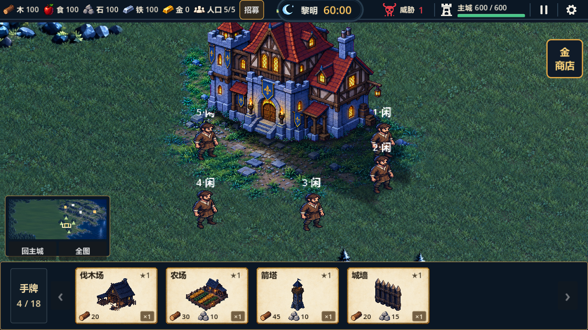

# 草地重设计：静态版本已接入

生成：2026-10-26；静态接入及验证：2026-10-27。当前游戏使用高清平原草地，昆虫动画已取消；全图风动按静态接入后的新方案继续制作。

- [4K原尺寸局部](../../../../tests/reports/images/grass-static-2026-10-27/4k-native-crop.png)：从真实4K渲染目标直接裁切，没有放大。
- [全图](../../../../tests/reports/images/grass-static-2026-10-27/wide/1280x720-full.png)。
- [静态接入规格](../../../assets/specs/grass-redesign-v1.md)与[全图风动设计](../../../assets/specs/grass-field-wind-v1.md)。
- [运行验证](../../../../tests/reports/qa-2026-10-27-grass-static.md)。
- [近景原稿](detail-native.png)、[整体候选](overall-v2.png)、[生成来源](generation-record.json)。

原稿保留；overall-v1只作对照，整体设计图不直接替换运行地图。静态细节采用1448×1086原稿，216×162世界覆盖，连续随机偏移混合；只有一种原生叶型样区，未来仍可补充独立变体。

`wind/`和`scene-motion-preview.gif`只保留旧草簇实验，场景预览已移除虫子，不是新全图风动的完成结果。`beetle/`仅是取消方案的历史原稿及后处理记录，不接入游戏，也不再在当前预览中展示。历史检查见[候选QA](../../../../tests/reports/qa-2026-10-27-grass-concept.md)。

静态生产素材重建使用`tools/build_grass_material.py`，验证使用`tools/check_grass_material.py`；`tools/export_grass_concept_preview.py`仅重建历史草簇离线演示与来源记录。
