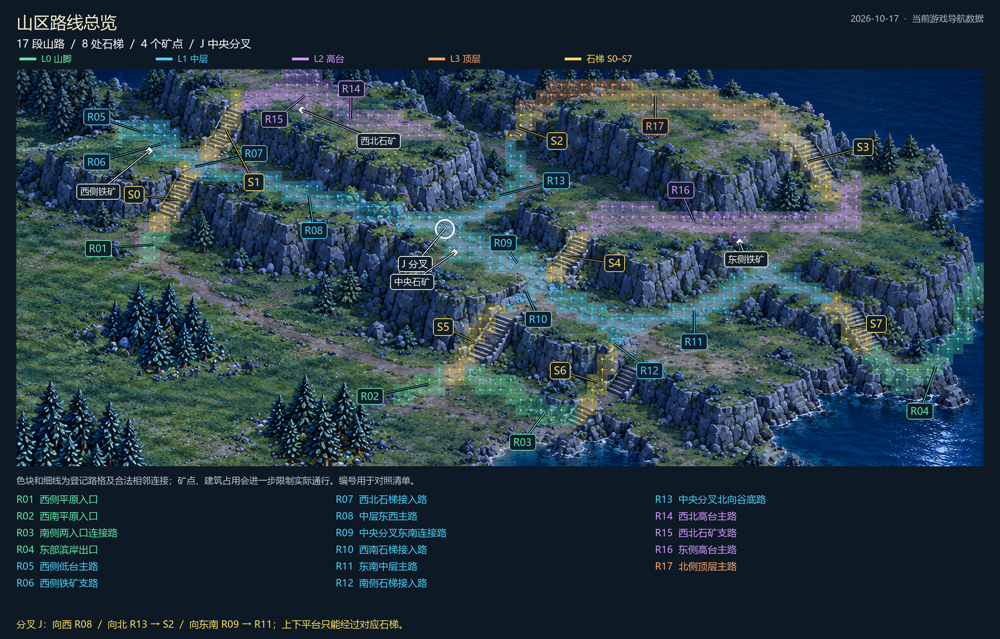

# 山区全部路线清单

整理日期：2026-10-17。依据当前运行导航数据生成；本次只整理路线，不修改游戏规则或地图。

## 山路

| 编号 | 位置/用途 | 层级 | 参考起点 → 终点（母图坐标） |
|---|---|---|---|
| R01 | 西侧平原入口 | L0 | [600, 242] → [613, 201] |
| R02 | 西南平原入口 | L0 | [922, 420] → [994, 390] |
| R03 | 南侧两入口连接路 | L0 | [994, 390] → [1160, 440] |
| R04 | 东部滨岸出口 | L0 | [1520, 357] → [1672, 260] |
| R05 | 西侧低台主路 | L1 | [650, 134] → [550, 90] |
| R06 | 西侧铁矿支路 | L1 | [610, 99] → [630, 92] |
| R07 | 西北石梯接入路 | L1 | [650, 134] → [678, 111] |
| R08 | 中层东西主路 | L1 | [650, 134] → [1020, 225] |
| R09 | 中央分叉东南连接路 | L1 | [988, 241] → [1121, 266] |
| R10 | 西南石梯接入路 | L1 | [1046, 305] → [1121, 266] |
| R11 | 东南中层主路 | L1 | [1121, 266] → [1480, 305] |
| R12 | 南侧石梯接入路 | L1 | [1195, 368] → [1200, 327] |
| R13 | 中央分叉北向谷底路 | L1 | [980, 205] → [1065, 95] |
| R14 | 西北高台主路 | L2 | [713, 44] → [960, 85] |
| R15 | 西北石矿支路 | L2 | [800, 46] → [800, 20] |
| R16 | 东侧高台主路 | L2 | [1155, 215] → [1472, 159] |
| R17 | 北侧顶层主路 | L3 | [1086, 55] → [1416, 83] |

## 石梯

S编号保留游戏数据原始编号，从0开始；层级只约束通行，不增加移速或战斗属性。

| 编号 | 位置 | 连接层级 | 相接道路 |
|---|---|---|---|
| S0 | 西侧上山口 | L0 ↔ L1 | R01 ↔ R05 / R07 / R08 |
| S1 | 西北高台石梯 | L1 ↔ L2 | R07 ↔ R14 |
| S2 | 北侧谷底石梯 | L1 ↔ L3 | R13 ↔ R17 |
| S3 | 东北高台石梯 | L3 ↔ L2 | R17 ↔ R16 |
| S4 | 中央高台石梯 | L1 ↔ L2 | R09 / R10 / R11 ↔ R16 |
| S5 | 西南上山口 | L0 ↔ L1 | R02 / R03 ↔ R10 |
| S6 | 南侧上山口 | L0 ↔ L1 | R03 ↔ R12 |
| S7 | 东侧下山口 | L1 ↔ L0 | R11 ↔ R04 |

## 各入口与矿点

- 西侧入口：平原 → R01 → S0 → 西侧中层路网。西侧铁矿由R05附近的R06支路接入。
- 西南入口：平原 → R02 → S5 → R10。
- 南侧入口：平原 → R03 → S6 → R12 → R11。R03连接S5、S6下端，平原仍可自由寻路。
- 东侧入口：R04 → S7 → R11；R04另一端通向东侧地图边缘。
- 西北石矿：西侧中层 → R07 → S1 → R14 → R15。西北高台在岩缘终止，不能直接跨崖进入中央谷底。
- 中央石矿：J分叉 → R08末端附近/R09西端附近的合法采集边缘；矿点占地不能穿越，实际入口由当前占用决定。
- 东侧铁矿：R11 → S4 → R16，或北侧顶层R17 → S3 → R16，取当前起点下较短的合法路线。

## 中央分叉 J

母图坐标(980,205)，层级L1。向西接R08，向北接R13并经S2抵达R17，向东南经R08末段接R09及R11。单位按目的地与当前占用选择最短合法路径；道路封闭时重算，有替代路才绕行，无路则停止。

## 阅读边界

- 共17条参考折线、8处石梯、538个道路/石梯登记格。R编号依导航数组顺序，仅用于文档，并非固定巡逻顺序。
- 图上色块显示已登记道路格，细线连接符合层级/石梯规则的相邻格；资源和建筑的运行时占用还会进一步阻挡。
- 裸岩、垂直石壁和水域不能移动或建造；山区离路草台不能走，仍按既有建造规则判断能否建造。
- 石梯可走、不可建。L2西北高台与L2东侧高台不是同一块连续地面；不能只凭层级相同越过岩壁。
- 36像素网格仍有边缘离散误差；这是当前数据总览，不代表新增了全部岩缘的人工验收。
- 上次真实游戏选路证据：[分叉QA](../../../tests/reports/qa-2026-10-17-junction-routes.md)。本次未重跑玩法测试。

## 数据与复用

[全部路线坐标JSON](routes.json)。源数据：`assets/map/dawn_large_v1/mountain-navigation.json`。
源数据SHA256：`12a052a294bdbcdb3386f2d0d2a9a0ab80413c51b3c613d2baf23c5a4aaec9bc`。
重建：用带Pillow的Python运行`tools/export_mountain_route_atlas.py`。
