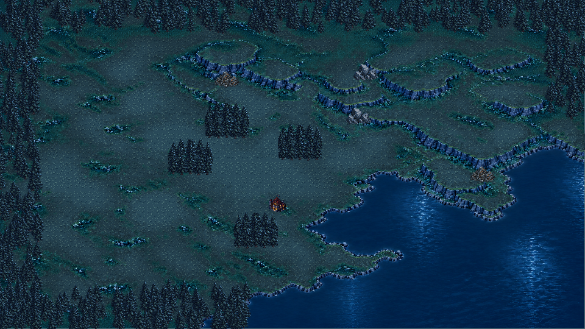
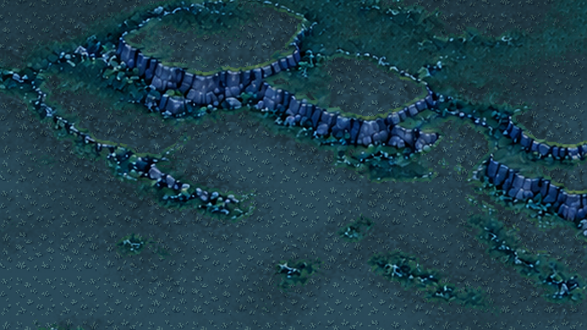
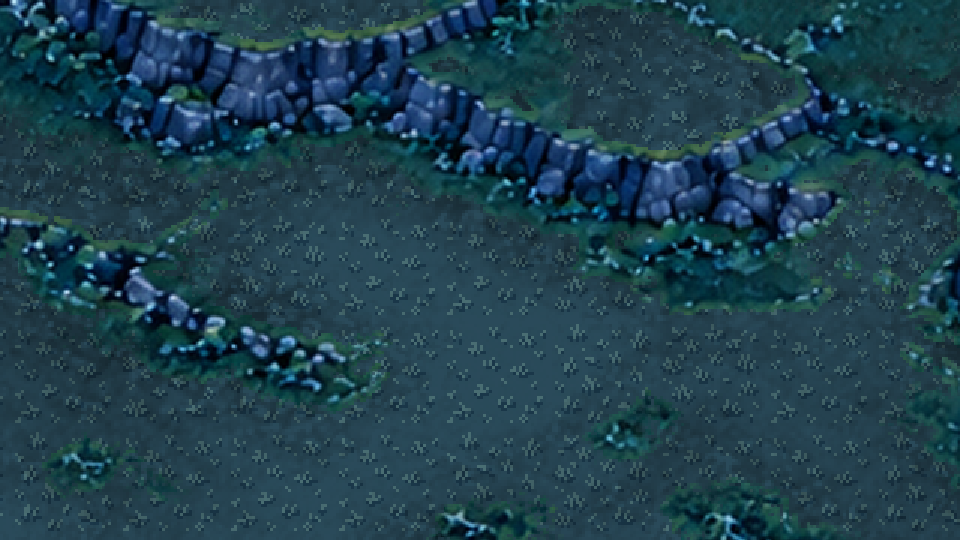
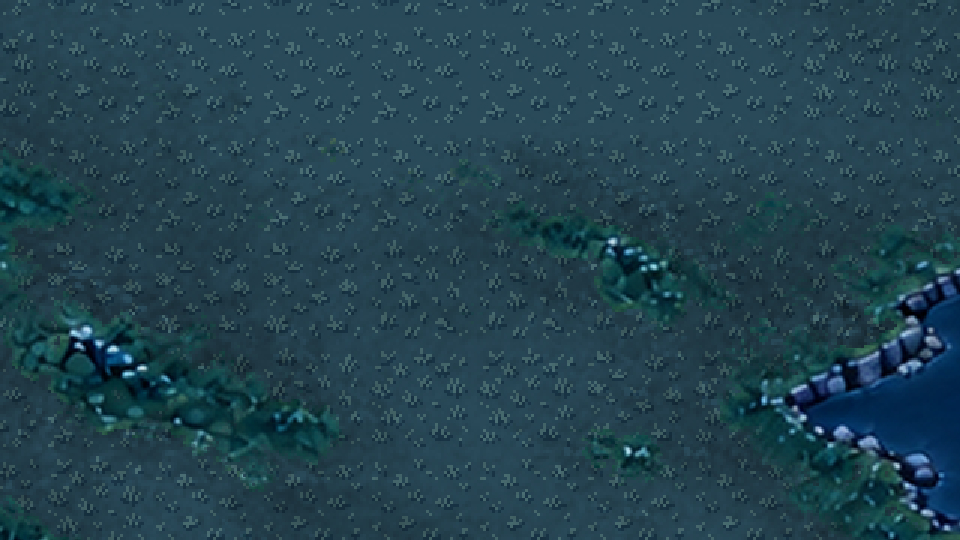

# 草地清晰度与山坡立体感优化 QA

日期：2026-09-30。环境：Godot 4.7 Standard，Windows，GL Compatibility / AMD Radeon 780M。对应Story-030，保留任务开始时已有未提交改动。

## 原因与改动

原草地图块不透明，视觉岩壁范围与逻辑崖壁格不完全一致，导致实际岩面和坡脚被盖住；源稿经平滑缩小后仅改为最近邻展示，不能恢复已丢失的细节。

使用内置图像生成按用户设计图制作灰蓝短草v2；首稿未通过默认对比度与差异QC，重新生成后通过。脚本仅作切片、色彩均衡、最近邻采样、12色量化和统一边缘，不程序绘制正式草叶。保留源稿、首稿与提示词，四个36×36素材支持独立复用。

运行时默认2×2逻辑格展示草地，整数放大并适当降低细节对比；构建格仍为36像素。材质基于现有底图保护岩面与湖水，继承地表低频明暗，取消逻辑岸/崖矩形视觉边界。树木、矿点、建筑和单位仍独立，地形与寻路数据没有改动。

## 验证

- 地形与建筑落地专项：34项通过；新增共享12色、跨变体边缘、保坡材质与2×2格显示尺度检查。
- 全量回归：29组1083项通过，0失败；包含建造、网格、寻路、资源、经济、对局及UI。
- 非headless真实GL输入冒烟：28项通过，检查滚轮、平移、触控、拖牌、岗位、商店及满手牌；不是仅以无头模式替代图形验证。
- 独立真实GL地形视觉：10项通过，6张截图成功输出；1.0和1.5倍率分别抽样11861与17428个强冷蓝岩面像素，草地显示前后平均RGB差均为0；新草地在两倍率中均真实绘制并覆盖草地区域。
- 图集严格QC：四变体对比度分别0.054334、0.061654、0.058145、0.057900，均高于默认0.035；最小变体差异0.039140，高于默认0.025；无警告。
- 使用相同源稿和参数重建图集，SHA256与交付图集一致。
- Godot资产导入与真实GL材质编译通过；`tools/check_project.ps1`、`git diff --check`通过。

复验命令：`pwsh -File tools/run_tests.ps1 -GodotPath '本机Godot控制台路径'`；视觉：`godot --path . res://tools/check_terrain_visuals.tscn`，必须使用真实图形后端。

## 截图目检

检查全图岩壁与岸线连续性，1.0和1.5倍率坡面没有逻辑矩形切口，草叶保持硬像素边缘，坡脚仍有暗部与岩块亮面。这里是视觉实现和技术验证，不代替用户最终审美确认。

## 已知限制与下一步

保坡材质依赖当前冷蓝岩面色差，新地图必须指定相匹配的`relief_source`或另制保护图；颜色遮罩不用于碰撞，不代表通用高度/坡地系统完成。原底图岩石本身的柔软细节未重绘。本轮没有新增天气、高低地机制、Y排序或动态单位避让，也没有完成60分钟自然试玩与多分辨率人工验收。

下一步由用户评审草地密度、色调与立体效果，再继续水岸/崖壁模块化。草地复用规则见`assets/tilesets/moonlit_grass_v2/README.md`，旧v1保留，不删除历史素材。
