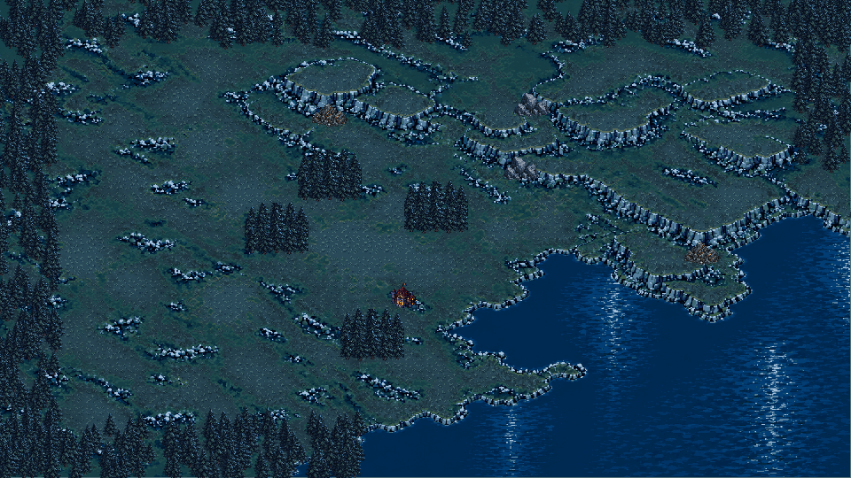
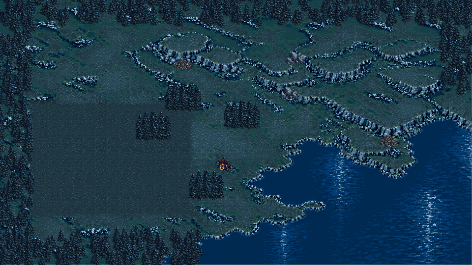
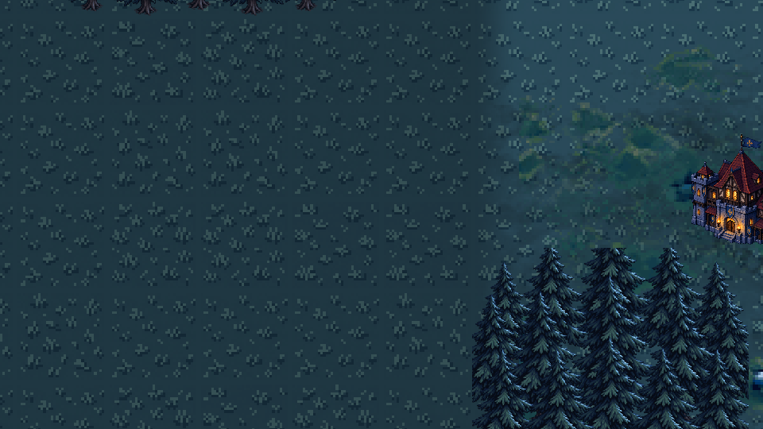

# 左侧平原装饰石头清理（2026-09-30）

## 范围与结论

按用户最终红框要求，只去掉左侧平原装饰石头，不重新设计。复用现有草地v2覆盖世界矩形`(180,612,1008,720)`的装饰岩面，并清除石堆明暗残影；在区域内缘36世界像素衔接原明暗。当前运行底图与草地图集文件不变。独立树林、矿点、建筑、人物、山坡、湖岸、框外石头、资源位置、建造与寻路规则不变。

实施和验证通过，范围最终目检待用户确认。此前“地形与主城清晰度不匹配”的反馈没有因本次清理而解决，不宣称全图美术清晰度合格。

## 验证

- 全量：29组1095项通过，0失败；日志`.codex-temp/qa-20260930-145712/`。
- 地形专项：46项通过，新增清理开关及局部范围参数回归。
- 真实GL视觉：24项通过，包括16张截图、山坡材质6项及局部清理2项；GL Compatibility / AMD Radeon 780M。
- 真实GL交互：28项通过，覆盖拖牌建造、岗位、商店、滚轮/触摸镜头与手牌翻页。
- 局部前后对照：停止实体动画，在同一镜头下只切换`clear_left_plain_rocks`；区域内74505像素变化，区域外0内容差异、0一色阶舍入差异。比较按像素中心反变换到世界坐标，最多允许1/255色阶舍入，不能把框外实质内容变化计为通过。
- Godot导入、`tools/check_project.ps1`、`git diff --check`通过。

## 截图

清理前：

清理后（树林与资源点保留）：

最大1.6倍率清理区域：

## 实现与后续

运行实现位于`src/gameplay/art/terrain_grid_layer.gd`和`src/gameplay/art/grass_relief.gdshader`。既有PNG仍保留原始装饰，实际游戏通过当前草地材质覆盖；通过关闭清理开关可恢复原显示。不调整权威阻挡格，不增加新的资源或碰撞。

未接入的重设计参考、草地v3及临时构建脚本已移到`.codex-temp/abandoned-terrain-redesign-20260930/`，可恢复但不进入运行或交付。未提交、未推送。下一步仅由用户目检清理范围，不自动继续重设计。
