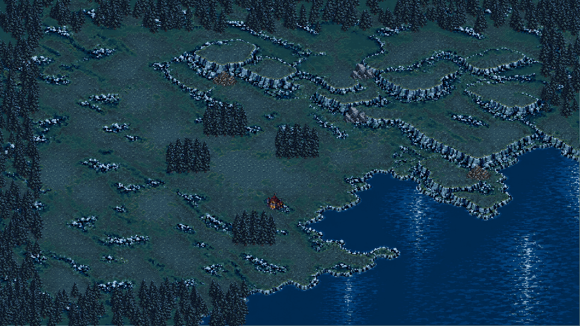
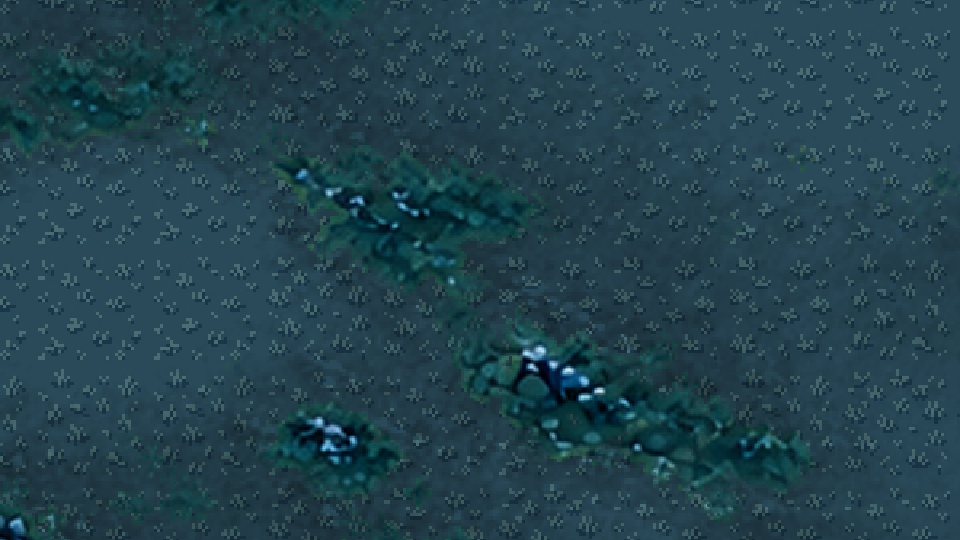
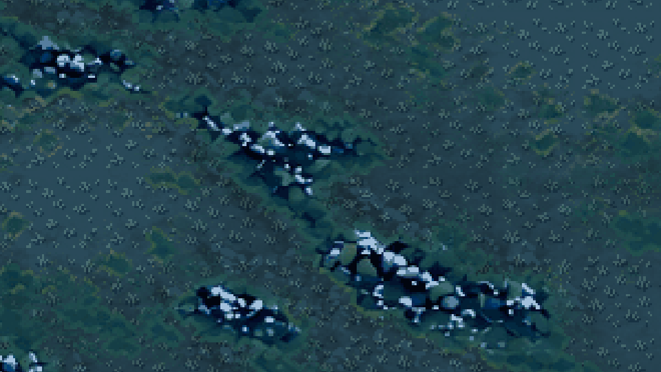
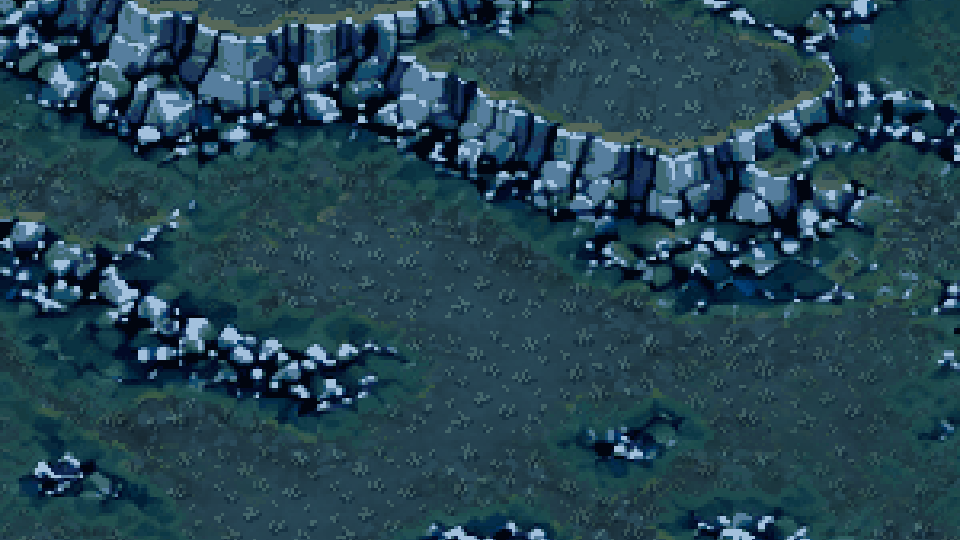
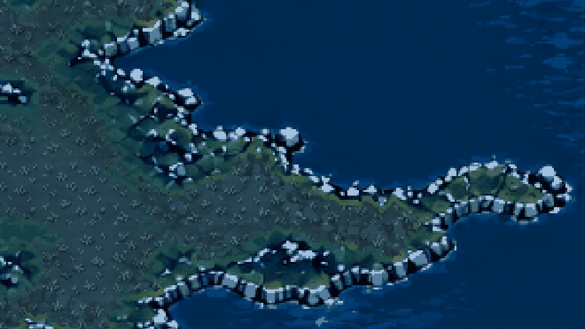

# 地形放大清晰度续修验证（2026-09-30）

## 结论

实现与自动化通过，最终美术审美和自然湖岸走位待用户评审。修复针对底图自身的软化细节：旧底图已经Nearest/Lossless，单改过滤无法恢复碎石与坡脚。此次以内置图像生成进行两轮重绘，第二轮加强硬边、多面体亮暗、裂缝和接触阴影；不通过降低最大镜头倍率掩盖问题。

## 范围和素材

- 当前底图：`assets/map/moonlit_resource_map_16x9_terrain_crisp.png`，2880×1620，64色，2×2世界像素美术格；Lossless、Nearest、无mipmap。
- 最终生成源稿：`assets/map/moonlit_resource_map_16x9_terrain_crisp_source.png`，实际1672×941；同名`.prompt.txt`保留手写提示词。
- 首轮编辑稿：`assets/map/moonlit_resource_map_16x9_terrain_crisp_draft_source.png`及同名提示词。首轮基于旧底图，第二轮基于首轮稿；第二轮选为正式源图。
- 原图`assets/map/moonlit_resource_map_16x9_base.png`未改，供对照和回退。
- `tools/build_crisp_terrain.py`仅进行比例/最小尺寸检查、最近邻尺寸规范、64色量化和2×整数放大，不程序绘制正式岩石、不伪造源图细节。实际原生格1440×810，不声称2880×1620全为原生细节。
- 主场景底图和草地材质的保护/明暗采样同步换为新图；资源清单仅改`base`，八处资源坐标、贴图和实体层不变。地图重建工具的未来输入也同步更新，本轮未重建无关资源素材或历史静态合成预览。
- 草地v2四个36×36变体、默认2×2逻辑格展示和网格复用方式保持不变。边界树林、交互矿点、建筑、单位、HUD没有烘焙入底图。

## 验证结果

| 验证 | 结果 |
|---|---|
| Godot 4.7导入/脚本解析 | 通过，无错误 |
| 地形与建筑落地专项 | 44项通过，新增10项：源图引用、尺寸、2×2像素块、64色、来源清单、采样规范、源图/提示词存在、无损无mipmap、资源清单一致、主底图/遮罩一致 |
| 全量回归 | 29组1093项通过，0失败；日志`.codex-temp/qa-20260930-110702/` |
| 真实GL地形验证 | 20项通过，AMD Radeon 780M / OpenGL 3.3 Compatibility；14张截图保存及6项材质检查 |
| 真实GL交互冒烟 | 28项通过；开局、拖牌、镜头鼠标/触摸输入、岗位、商店、满手牌与占地覆盖 |
| 确定性重建 | PNG与JSON分别SHA256一致 |
| 项目结构与差异格式 | `tools/check_project.ps1`和`git diff --check`通过 |

真实GL分别比较新地形底图本体与叠加草地后的画面，抽样`b-g > 0.075`的岩面像素；此项证明草地没有覆盖新岩面，不是旧图与重绘图必须像素相等的测试。

| 镜头倍率 | 岩面抽样数量 | 平均RGB绝对差总和 | 草地实际改动像素 |
|---|---|---|---|
| 1.0 | 19564 | 0.000000 | 33743 |
| 1.5 | 23914 | 0.000000 | 32987 |
| 1.6 | 24113 | 0.000076 | 34769 |

检查代码位于`tools/check_terrain_visuals.gd`；拒绝headless作为视觉结论。前后对照使用同一960×540视口、同一1.6倍率、相同镜头位置和草地v2，只切换地形底图及材质的源图输入。

## 目检和前后对照

目检：第二轮相较旧图的碎石亮面和外轮廓更明确，崖壁正面/侧面分层更强，湖岸岩块以硬像素边缘呈现；没有增加树、互动矿点、道路或建筑。全图与实际GL交互截图确认现有分层素材、建筑岗位和手牌仍可显示。



最大1.6倍碎石，修复前：



最大1.6倍碎石，修复后：



最大1.6倍崖壁，修复后：



最大1.6倍湖岸，修复后：



相同目录保留`before-cliff-1.6x.png`和`before-shore-1.6x.png`作为旧图对照，`gameplay-workers.png`为1.5倍率建筑岗位交互截图。

## 重建与复用

```powershell
python tools/build_crisp_terrain.py --input assets/map/moonlit_resource_map_16x9_terrain_crisp_source.png --reference assets/map/moonlit_resource_map_16x9_terrain_crisp_draft_source.png --output assets/map/moonlit_resource_map_16x9_terrain_crisp.png
godot --headless --editor --quit --path .
pwsh -File tools/run_tests.ps1 -GodotPath '本机Godot控制台程序路径' -Filter test_terrain_grid_rendering
godot --fixed-fps 60 --path . res://tools/check_terrain_visuals.tscn
```

确定性重建到临时目录后对照：

- PNG SHA256：`47a37b787969503943c8346c7c0a454b79809398bd0f830386cc0d3d540ad5be`。
- JSON SHA256：`849938fa39b1e33c36cd64f4d9c2d48f25061ca8d9195549db69c292508a24e3`。
- 最终生成源稿SHA256：`79d3ef43e99ffe762ab3e3bff936d953c5a5936ae8962ad1bd57fb755e4f5749`。

草地作为独立图集可在后续地图按1～4格复用；本轮整张山坡湖泊底图仍只适合现有地图。水岸和崖壁的独立连接块需另行生成规格、制作和拼接验证，不能切碎本图后声称已完成模块化TileSet。

## 已知限制与下一步

1. 新图沿用原整体构图，重绘不保证旧岸线每个像素逐点相同；360×203颜色阈值/连通水域粗采样IoU约0.9374，仅作构图诊断，不作为碰撞对齐证明。权威水域、崖壁、建造和寻路数据完全未改，湖岸自然走位和最终美术仍待用户评审。
2. 保坡颜色遮罩依赖当前灰蓝岩面/水面与灰绿地表配色，不是通用高度图。最大倍率为1.6，没有增加更大倍率；在非整数屏幕倍率下Nearest允许像素宽度交替，但不产生线性混色。
3. 64色量化会简化细微颜色；真正细节来自图像生成稿，不能把整数放大解释为新增分辨率。正式水岸/崖壁地块、Y排序、动态单位避让、其他分辨率及60分钟自然试玩不在此次完成范围。
4. 用户已有草地优化改动全部保留，未提交、未推送，`.godot/`与`.codex-temp/`不纳入交付文件。
