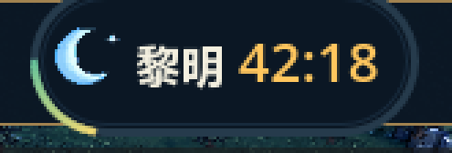
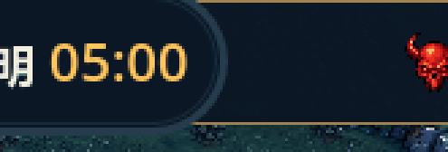
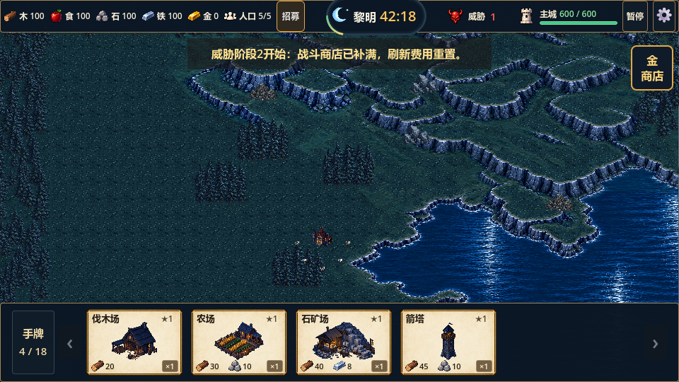
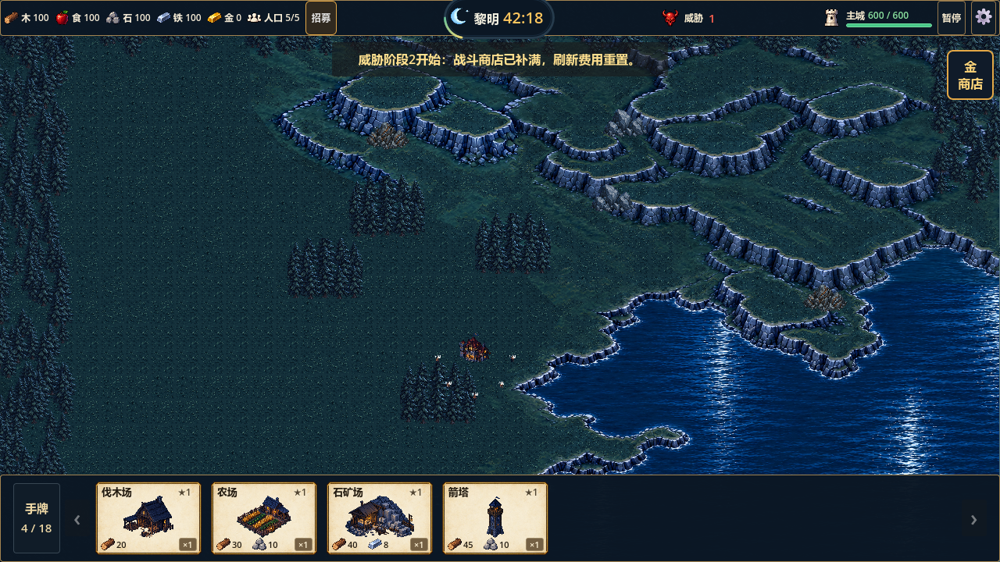
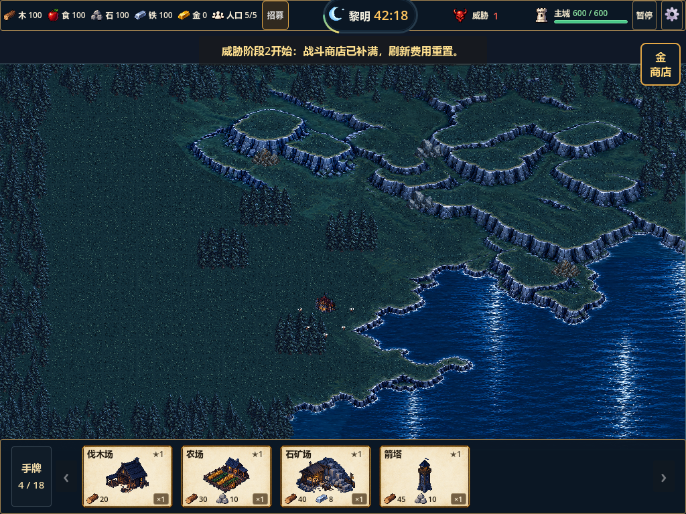

# 黎明胶囊与日月转换验证

- 日期：2026-10-09；引擎：Godot 4.7 Standard / GL Compatibility；Story：026。
- 结论：本轮计时胶囊修正与8帧日月转换已接入并通过技术验证，最终美术仍待用户复核。

## 结果

此前计时区域只有月亮与一行文字，本轮补设计图的独立深蓝圆角胶囊、蓝灰双层轮廓、下缘突出顶栏及左下绿黄进度弧；保留白色“黎明”和金色真实倒计时。8帧独立生成素材经品红去底、共享缩放与固定画布处理，运行图集512×256。整局圆弧按有效时间推进，最后5分钟月牙逐渐转太阳，相邻帧淡入；暂停冻结，商店展开继续，重开恢复。只改展示，不引入昼夜战斗或天气机制。

## 验证证据

| 验证 | 结果 | 证据 |
|---|---|---|
| 素材严格QC | 8帧有效、0空帧、0触边、0粘贴裁切，共享缩放0.3953667954 | `assets/ui/day_night_clock_v1/pipeline-meta.json` |
| 全量回归 | 31组1208项，0失败；包含日月30项、60分钟23项、HUD59项 | `.codex-temp/qa-20261009-141620/` |
| 日月真实GL | 30项、退出0、无脚本错误 | `.codex-temp/day-night-gl.out.log` / `.err.log` |
| HUD真实GL | 59项、退出0、无错误，交易/合成/刷新与布局保持 | `.codex-temp/day-night-test_hud_reference_visuals.out.log` / `.err.log` |
| 真实输入GL | 28项、退出0、无错误，拖牌/镜头/商店交互保持 | `.codex-temp/day-night-test_settlement_ui_smoke.out.log` / `.err.log` |
| 960×540 / 1280×720 / 1024×768 | 三视口截图目检，文字在胶囊内，顶栏不越界，招募/威胁不重叠 | 下方保存截图 |
| 导入/解析 | 最终导入退出0，无ERROR或SCRIPT ERROR | `.codex-temp/day-night-final-import.log` |
| 项目检查 | `tools/check_project.ps1`、`git diff --check`通过 | 本轮执行输出；仅已有CRLF提示 |

专项通过实际 `RunState.advance_campaign_time` 检查42:18的整局圆弧、05:00开始过渡、02:30相邻帧混合、暂停冻结、商店不暂停、00:00完整太阳与胜利、重开60:00月牙。截图前冻结敌人和农民用于稳定观察；不把受控快进当作自然试玩。

## 游戏内截图与动画

GIF取真实Godot渲染的15个展示采样帧，末段05:00→00:00加速并循环供复核，裁切区域三倍最近邻显示。实际游戏按有效300秒推进，不按GIF速度播放，也不会归零后循环回月牙。

过渡、黎明结算和重开截图另存同目录 `transition-02-30.png`、`dawn-00-00.png`、`reset-60-00.png`。

## 边界与下一步

源稿、完整提示词、清理稿、图集、八帧、GIF、元数据和处理命令均保留。素材仍为candidate；最终轮廓、色彩和转换节奏待用户游戏内目检。完整60分钟自然试玩、跨显示器全屏及键盘/手柄操作未由本轮验证覆盖。下一步按用户视觉反馈调整，不自动展开地形或经济功能。
