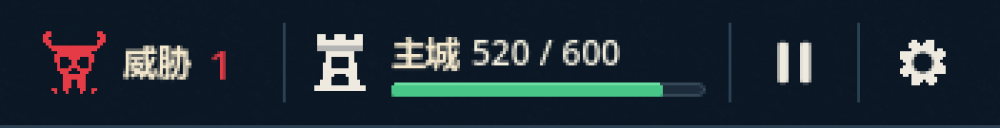
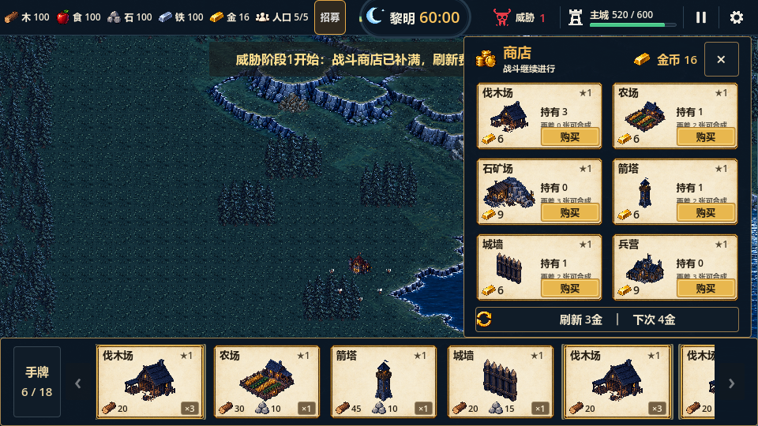
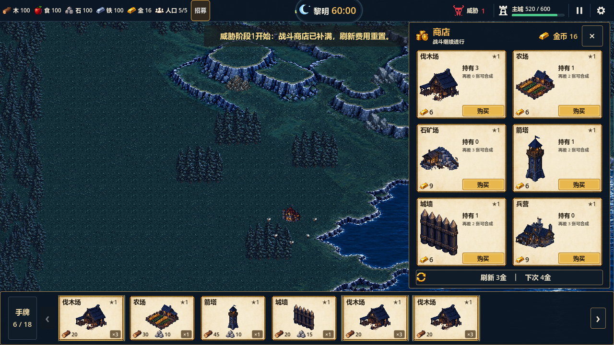
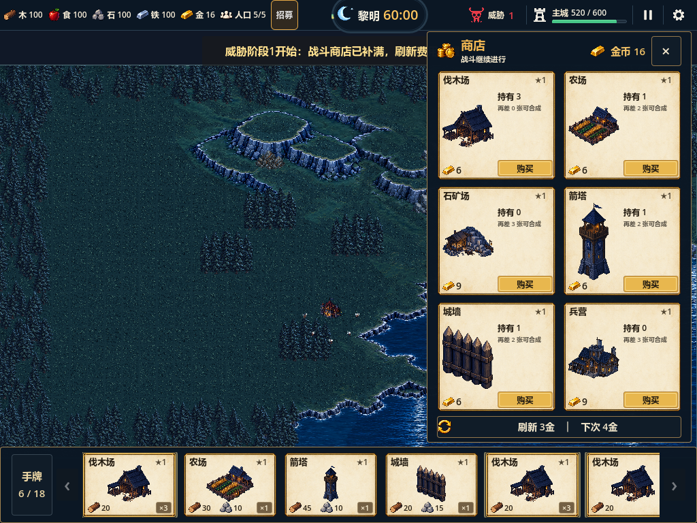

# 顶栏右侧状态与控制区优化验证

- 日期：2026-10-09；Story：026；Godot 4.7 / GL Compatibility。
- 结论：右上红框样式调整已接入并验证，最终视觉待用户复核。

## 实现

按原始设计图将右侧收为连续紧凑分区：简洁红色角骷髅与威胁数值，白色城堡/主城/耐久数值，下方110×5逻辑像素生命条。分区以蓝灰竖线区分，顶栏下缘改为蓝灰细线。暂停和设置改为白色图形、透明常态背景、深蓝悬停反馈；每个按钮44×44，内部18×18符号。暂停后显示继续三角，继续后恢复双竖条，设置仍打开原显示设置。

图形在 `src/gameplay/art/hud_status_symbol.gd` 中使用固定32×32坐标绘制，不依赖系统字体的彩色齿轮。原12图标图集保留，资源和商店继续复用，顶栏的威胁/主城改用简洁图形。日月胶囊、地图、经济和胜负规则保持原有实现。

## 验证

| 验证 | 结果 | 证据 |
|---|---|---|
| 全量回归 | 31组1227项通过，0失败 | `.codex-temp/qa-20261009-153622/` |
| 真实GL HUD | 78项、退出0、无错误 | `.codex-temp/status-test_hud_reference_visuals.out.log` / `.err.log` |
| 真实GL输入 | 28项、退出0、无错误 | `.codex-temp/status-test_settlement_ui_smoke.out.log` / `.err.log` |
| 真实GL日月 | 30项、退出0、无错误，胶囊与暂停仍保持 | `.codex-temp/status-test_day_night_clock.out.log` / `.err.log` |
| 三视口 | 960×540 / 1280×720 / 1024×768截图目检通过，状态区/按钮不越界、不覆盖胶囊 | 下方截图 |
| 导入、结构与差异 | 最终导入无脚本错误，`tools/check_project.ps1`、`git diff --check`通过 | `.codex-temp/status-final-import.log`及本轮命令输出 |

新增19项HUD断言覆盖真实鼠标暂停/继续、暂停时打开设置且不恢复对局、有效时间冻结、主城受80伤害后520/600与生命条比例、三个视口下的右侧区域和44像素按钮、重开满耐久与符号恢复。购买、售罄、刷新、合成和手牌真实输入继续通过。

## 游戏内效果

细节图为真实960×540截图的三倍最近邻放大，便于观察符号与分隔线。

暂停、启动和暂停时设置截图存于同目录 `paused-960x540.png`、`boot-960x540.png`、`settings-paused-960x540.png`。

## 边界与下一步

本轮验证了图形控件和真实状态/鼠标交互；不把技术通过当作最终美术批准。跨显示器全屏切换、设置持久化、键盘/手柄与完整60分钟自然试玩仍待后续。下一步根据用户对右上红框的视觉反馈修订。
