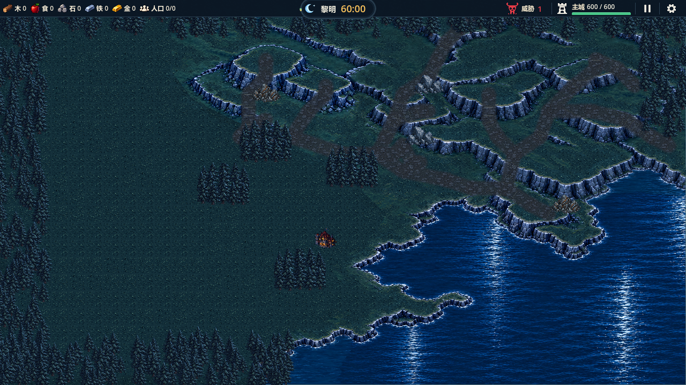
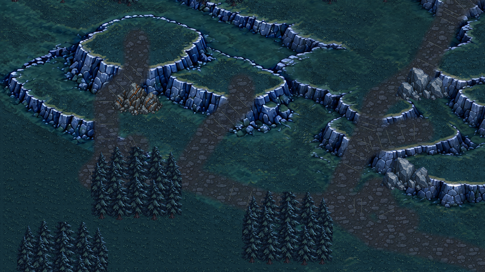
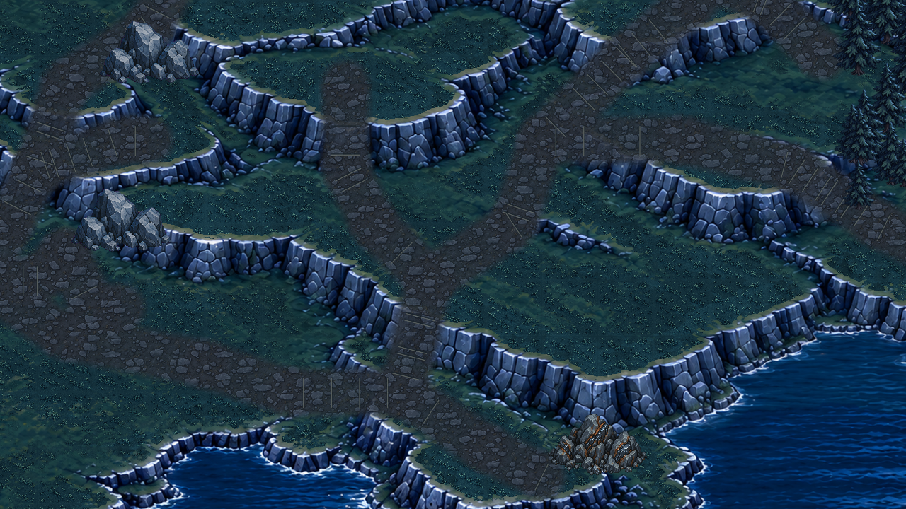
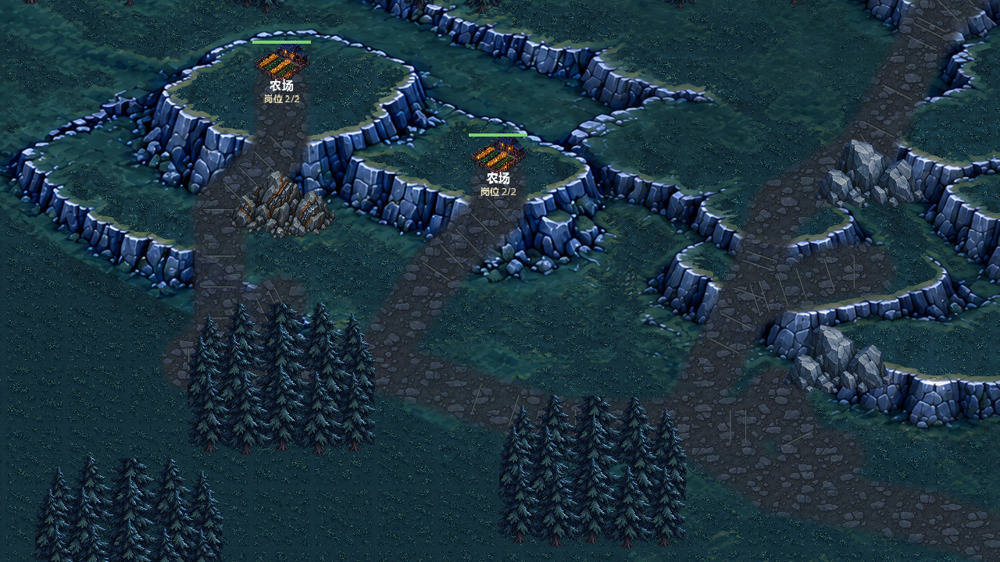

# 薄顶栏与山区资源道路验证

- 日期：2026-10-10；承接2026-10-09中断任务。Story-030，关联026/029；Godot 4.7 Standard / GL Compatibility。
- 结论：用户要求的顶栏降高、山区道路、草台可建/裸岩禁建已接入并通过验证；最终视觉待用户复核。

## 最终行为

顶栏44降至32逻辑像素，约减少27%；计时控件142×32、圆弧外框下缘突出4像素。白色控制符号居中，暂停/设置点击区域44×32，招募高度32，岗位等其他44×44控件保留。计时标签延迟收紧为61×26，避免Godot字号切换后的旧高度缓存越出胶囊；暂停、商店和最后5分钟日月转换仍读取真实有效时间。

山区新增72世界像素路幅的主干、四矿入口与山台支路，通过岩质坡道跨越崖壁。显示及地形开放共同读取`design/levels/mountain-resource-routes.json`；草地和草地道路可走可建，裸岩不可走不可建，岩质坡道可走不可建；道路不加速，水域、资源专用格、建筑/单位占用规则保持。

旧三段粗崖壁范围改为`mountain-rock-cells.json`，离线每格12×12取样、18%岩面门槛登记795个候选岩面格，水域/资源/坡道之后覆盖。运行不读取图片颜色做碰撞，换图需重建并人工复核固定36像素边缘。底图、草地、主城和八资源坐标保留。

## 素材来源

2026-10-09两次新道路图集生成请求均HTTP429，没有PNG产物。最终复用2026-09-20图像生成的ENV-002 `assets/art_candidates/night_set_v1/terrain_road.png`（1254×1254 RGBA）；源图未改，原生成提示在同目录README。连续世界UV、透明度边缘和路向踏面只负责运行映射，没有用程序绘制石土素材。候选来源及失败记录见`assets/map/mountain_roads_v1/`；四边无缝接缝变体未制作，不宣称正式TileSet或最终美术批准。

## 验证证据

| 验证 | 结果 | 本地日志 |
|---|---|---|
| 全量回归 | 32组1290项、0失败 | `.codex-temp/qa-20261010-090031/` |
| 山区道路与建造 | 58项通过 | 同目录`test_mountain_resource_routes.out.log` |
| 真实GL顶栏/交易/暂停 | 81项、退出0、无错误 | `.codex-temp/thin-hud-gl-final-20261010/test_hud_reference_visuals.out.log`及`.err.log` |
| 真实GL日月转换 | 30项、退出0、无错误 | 同GL目录`test_day_night_clock.out.log`及`.err.log` |
| 真实GL鼠标交互 | 28项、退出0、无错误 | 同GL目录`test_settlement_ui_smoke.out.log`及`.err.log` |
| 真实GL道路与草台落成 | 8项、退出0、无错误 | 同GL目录`mountain_visuals.out.log`及`.err.log` |
| 岩面确定性重建 | 前后JSON SHA256一致 | `python tools/build_mountain_terrain_data.py`及本轮校核命令 |
| 导入、结构、差异 | Godot导入无脚本错误；项目结构及`git diff --check`通过 | `.codex-temp/mountain-final-import-20261010.log`及本轮命令输出 |

58项山区专项包含四矿真实农民往返交付、资源建筑专用占用后的入口可达、路线/实际移动避开固体和斜角夹缝、四个草台实际建造及预览、岩壁拒绝且不扣手牌/材料、重置释放占用及路网保留。连通检查覆盖山区范围（列20～78、行1～29）所有可建2×2落点，不可达落点为0。

| 矿点 | 受控往返耗时 | 去程/回程路径点 |
|---|---:|---:|
| iron_02 | 17.30秒 | 16 / 13 |
| stone_01 | 19.20秒 | 18 / 16 |
| stone_02 | 13.60秒 | 12 / 10 |
| iron_01 | 26.50秒 | 25 / 26 |

单位使用原80世界像素/秒，0.05秒步进、采集1秒；以上仅为受控路线证据，不作为长局经济平衡结论。

GL路层开关对比（1280×720，2像素步进、允许一色阶PNG舍入与2世界像素采样误差）路网内14741个抽样点发生变化，路幅外变化0；确认可见道路没有重绘其他地图。960×540/1280×720/1024×768顶栏高度及计时/右侧区域边界、暂停/设置、六格商店和手牌截图已检查。

回归中发现计时标签保留旧高度，修复延迟布局后继续严格验证文字框位于胶囊内。镜头投放旧夹具900,300已落在真实岩面，改用无建筑/单位占用的平原684,216，并增加可建校验；农民死亡夹具由固定10秒等待改为真实携货状态及首次交付等待，继续严格检查仅幸存者2单位入账，没有放宽原断言。

## 实景截图

三视口商店截图见`images/thin-hud-2026-10-10/`，均为真实GL输出。

## 已知限制与下一步

固定地图颜色取样登记不是通用地形识别，36像素格在岩壁边缘仍有离散误差；最终道路纹理、正式坡道连接块和无缝接缝变体待美术精修。已有静态网格寻路不会强制单位只走道路，合法草地仍可通行；玩家建造仍可能堵路，动态避让与高密度同路体验未验。完整60分钟自然试玩、运输经济与怪潮到城时间仍待验证。下一步由用户在运行游戏中目检高度、道路与草台落点，本轮不提交或推送。
