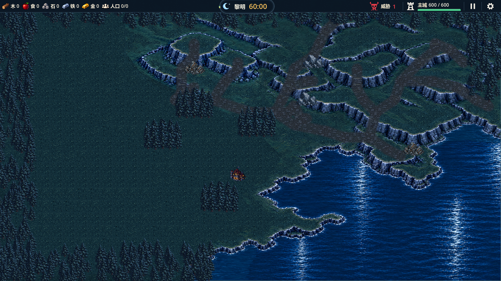
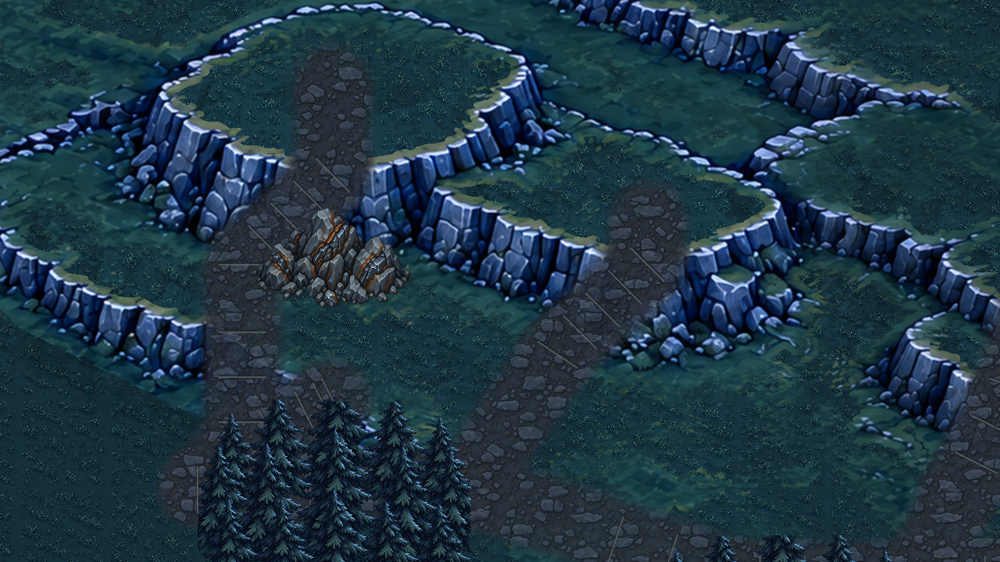

# QA：撤回石梯并恢复原道路

日期：2026-10-10。用户最终要求只撤回石梯更改，之前道路全部保留。

用户否定石梯效果并明确要求取消贴图、只撤回石梯更改且保留之前道路。已恢复原有72世界像素石土路带、岩坡原石路与原踏面提示线；石梯贴图、分段替换、抬升、侧壁、转角平台和阴影绘制全部撤回。草地道路、矿点路网、权威地形及建造/通行规则保持。两张生成候选及提示词移至本地忽略目录`.codex-temp/rejected-stone-stairs-20261010/`，不作为已批准或已接入素材。

## 验证

- 山区专项58项通过，日志`.codex-temp/qa-20261010-112425/`。
- GL Compatibility实景9项通过，日志`.codex-temp/roads-restored-gl.out.log`及同名错误日志；四矿路线、草台建造、顶栏32逻辑像素保持。
- 道路显示14747个变化抽样、设计路幅外0变化；全图、两处矿点视角、最大1.6近景与草台落成截图已目检。
- 源码无石梯/平台纹理预加载或绘制；原道路渲染已恢复。项目结构及差异检查通过。
- 此次为视觉撤回，仅重跑相关测试；完整32组1290项为此前历史基线，不记为本次复验。

## 实景

## 限制与下一步

当前道路仍为候选。自然格边缘走位、道路接缝变体、完整60分钟体验和纹理压力待验；用户未接受的石梯方案已停止，不自动继续修改或把自动测试通过当作视觉验收。
