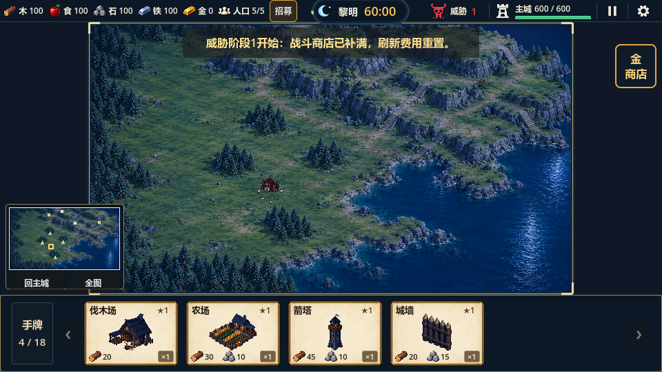
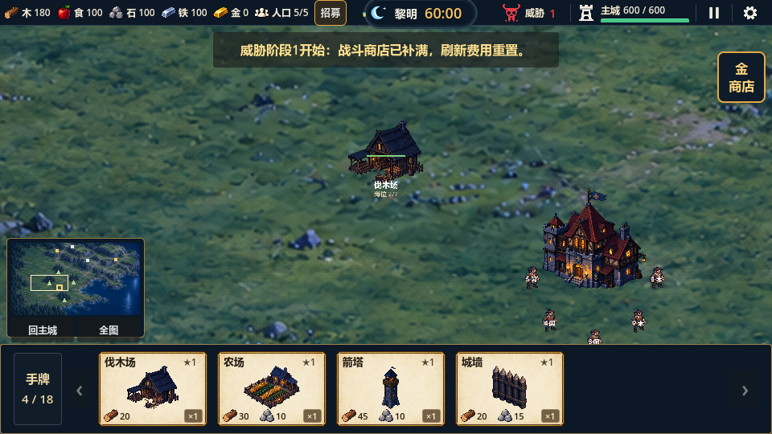

# 分层大地图验证报告（2026-10-13）

后续说明（2026-10-14）：首次续跑覆盖了本报告图片目录中的部分画面，原日志及历史结论保留；最新高清视觉、尺度和中间视口证据见[后续修复报告](qa-2026-10-14-map-visual-fixes.md)。旧初态RGB差0不适用于高清编辑后的候选。

结论：运行候选已接入，功能与受控回归通过；最终美术、高清细节与自然长局保留风险。用户确认实施方案后，最终明确先保留4608×2592尺寸继续收尾。

## 实施范围

世界从2880×1620扩到4608×2592，面积2.56倍；36像素格、建筑占格、单位速度、采集量和经济规则保持。地面12片、独立四簇树林/边界、12岩缘遮挡及8石阶；四林两石两铁由同一地图清单摆放。石阶可走不可建，草台可建，岩壁与水阻挡。主城近景、回城/全图按钮、可点击小地图与Home/M入口已接入。

母图提取依照用户确认的拆层方案，保留图像原像素；图片服务第一请求HTTP429，第二成功补全地面，完整原稿/提示词/记录保存在`assets/map/dawn_large_v1/`。初态离线层合成最大RGB通道差0；这不包含新加矿点、主城、HUD、单位或动态建造状态，不是运行画面所有状态逐像素一致的承诺。

## 已运行验证

| 验证 | 结果与证据 |
|---|---|
| 全量headless | 33组1402项，0失败；日志`.codex-temp/qa-20261013-122542/` |
| 大地图专项 | 112项：尺寸、母图合成、8资源原本完整草台、真实建造与交付、8石阶、失败保卡、镜头/小地图与重开 |
| 山区专项 | 58项：四矿实际往返、4草台建造、全部山区双格可建格与主城连通、岩/水/坡规则；不可达可建格数量0 |
| 真GL视觉 | 三视口33项，退出0、错误日志空；`.codex-temp/large-map-gl-final.out.log`/`.err.log` |
| 真GL输入 | 28项，退出0、错误日志空；`.codex-temp/large-map-input-final.out.log`/`.err.log`。覆盖真实拖牌、岗位点击、鼠标/触控平移缩放、商店与手牌翻页 |
| 引擎导入 | Godot4.7 Standard导入无错误，`.codex-temp/large-map-import.log` |
| 素材与项目 | 尺寸/alpha/权威格范围、7个本地文档链接、三视口证据检查通过；34个PNG/清单确定性重建SHA256一致；`tools/check_project.ps1`和`git diff --check`通过 |

旧测试的地图落点迁移到明确的新草地/山台，运输夹具改为足够时间或实际携货状态；没有通过减少断言掩盖失败。压力计时中移除逐请求日志打印，保留50次请求全部成功的整体断言，避免控制台I/O污染测量。旧草地素材测试仍保留独立工具验证，新运行场景明确检查分层底图。扩大地图还暴露了敌人追守卫旧脚点并错误改攻兵营的问题，本轮已修复，守卫46项及城墙32项回归通过。

## 运输测量

以80世界像素/秒、采集1秒、每趟2单位、单农民受控往返测量，完整路径避开固体与斜角。下表不是自然经济平衡结论。

| 资源点 | 往返秒 | 往返路径长度（世界像素） |
|---|---:|---:|
| forest_02 | 14.20 | 1050.9 |
| forest_04 | 11.40 | 828.7 |
| forest_03 | 12.10 | 883.9 |
| forest_05 | 10.50 | 758.4 |
| stone_01 | 48.45 | 3789.9 |
| stone_02 | 38.50 | 2997.0 |
| iron_01 | 60.20 | 4732.7 |
| iron_02 | 39.75 | 3094.6 |

50实际单位在GL场景推进180帧：更新P95 **0.673ms**、最大 **23.996ms**；GL帧间P95 **10.631ms**。`Performance.MEMORY_STATIC`约 **70.26MiB**，这是CPU静态内存监视值，不是显存。50次寻路请求（包含首算和缓存）22.17ms；路径缓存随占用版本清除，有界256条。首算仍有峰值，不宣称稳定60fps或任意规模压力通过。

## 画面证据

已查看960×540、1280×720、1024×768全图/近景、树林占用与恢复、石阶代表单位和最大倍率截图；单位在石阶上处于合法格，身体和标签可见。截图目录`tests/reports/images/large-map-2026-10-13/`。

## 已知限制与下一步

- 源图仍1672×941；12片只是组织方式，不提高原生密度。0.72近景及最大1.6倍率可见模糊，高清重绘尚未制作；保持母图构图的高清细化需另作美术验收。
- 树簇是依照母图提取的独立区域，包含周围少量地面与原阴影，使用生成补地承接隐藏；不是可任意复用的单棵树图集。
- 岩缘与岸边按36像素离散，局部误差仍需自然走位检查；山体是2D视觉，不包含真实3D高度战斗规则。
- 50单位验证证明本机短场景移动与开销，未实现动态避让；同路单位可能重叠。
- 运输时间明显增加，需完整60分钟自然试玩评估扩张、矿物供应和威胁来袭。未擅自提高速度或收益，未导出Steam构建。
- 下一步优先用户评审实际尺度与视觉，再按反馈处理高清素材和长局平衡。本轮不提交、不推送。
