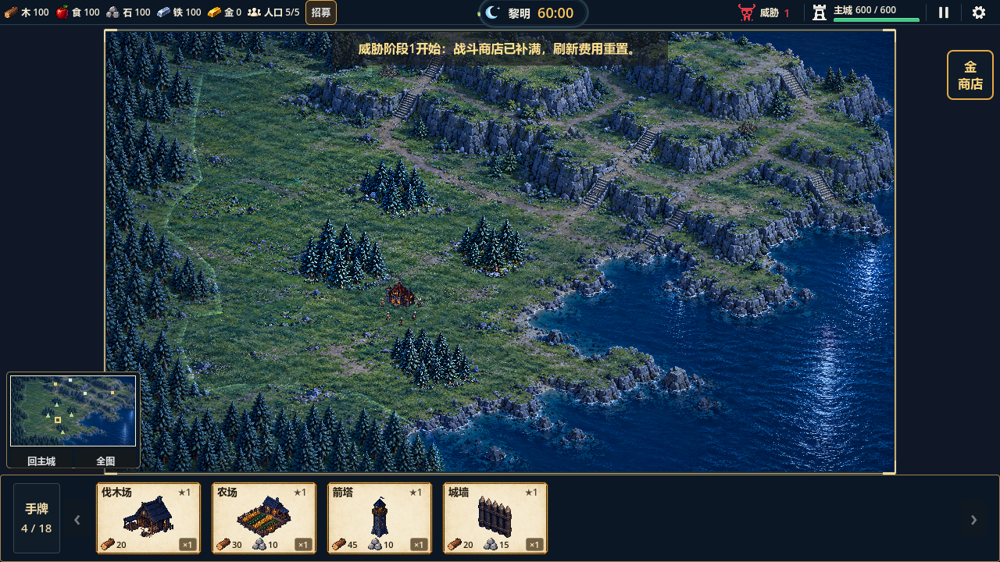
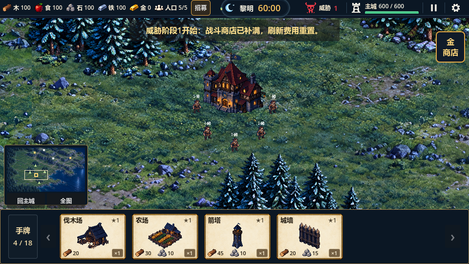
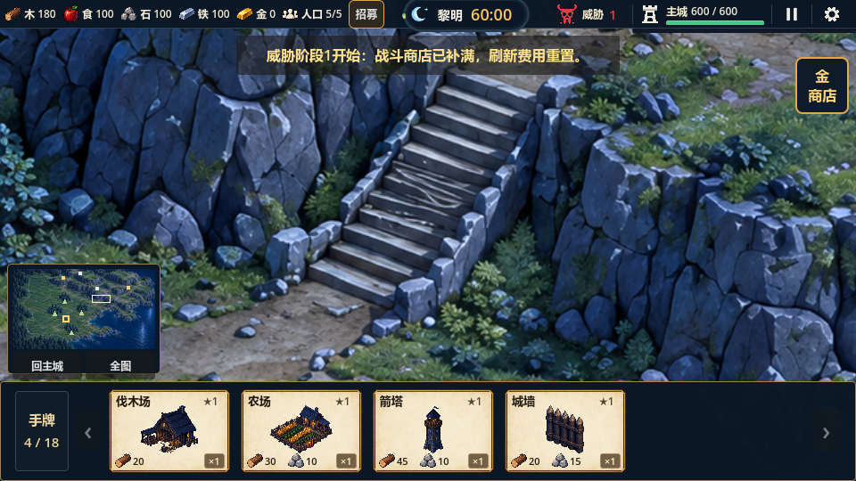

# 地图视觉与中间视口修复验证（2026-10-14）

运行候选已修复并验证。地图只在顶栏及突出胶囊的实际下缘到可见手牌上缘之间渲染和接收输入；镜头中心、全图缩放、四边限位、拖牌反变换、小地图镜头框使用同一矩形。胶囊外缘/圆弧也预留范围，地图上边界为37逻辑像素，顶栏本体仍32。HUD仍为屏幕层，全图等比居中并在宽高比不同时留边。隐藏HUD后的截图也证明栏位区域没有地图内容，不仅是用不透明面板遮住地图。

树林异常透明来自上一候选的宽矩形靠近检测：任意单位进入后整簇alpha降至0.28。已删除此策略，资源占用隐藏、销毁/重开恢复保持。高清树簇进一步去掉矩形草地，保留透明树冠、树干及脚点地物。单位视觉2.2倍、建筑2倍；姓名和生命条移到头顶，屋顶可点击岗位，HUD插画、36像素玩法格、占格、速度、经济和攻击半径保持。

内置image_gen制作12片高清地形、4处树簇、4片边界树林，另4次树簇透明提取，共24张成功原稿。已知2,0地形HTTP429、forest_05透明提取网络错误均重试成功。三份手写提示词、实际尺寸、参考路径、原始生成路径和SHA256保存在`assets/map/dawn_large_hd_v2/`。运行地形规范合成为5016×2823，源编辑稿约1448×1086；这不是单次原生5K生成。最大1.6镜头约1.47逻辑屏幕像素/地形源像素，旧版约4.41；四处树林使用更高细节密度。岩缘从同一高清地形裁切，避免旧模糊岩缘覆盖新底图。

## 已运行验证

| 检查 | 结果与证据 |
|---|---|
| 全量Godot headless | 33组1402项，0失败；`.codex-temp/qa-20261014-122516/`和`map-visual-fixes-full-complete.log` |
| GL三视口 | 960×540、1280×720、1024×768，共70项；`map-visual-fixes-gl-complete.log`，退出0，无脚本/失败错误 |
| 引擎真实输入 | 鼠标/触控缩放平移、真实拖牌建造、岗位、商店和18手牌翻页28项；`map-visual-fixes-input-complete.log`，退出0 |
| 高清素材QC | 24张真实生成稿/提示词/参考/哈希；12片实际密度≥1.08源像素/世界像素；树簇无整块不透明草地；33项运行输出确定性重建一致，权威玩法JSON未改；`map-hd-qc-final.log` |
| 引擎导入 | Godot4.7 GL Compatibility，高清地形及透明树簇导入无错误，`map-hd-cutout-import.log` |
| 项目检查 | `tools/check_project.ps1`和`git diff --check`通过；无提交或推送 |

旧镜头测试的整窗口全图倍率和画面四角断言已迁移为中间视口包围/居中断言；最初回归2组失败已解决。GL测试第一次布局尚未稳定时2项失败，等待布局完成后通过。新增单位尺度检查时出现测试局部变量重名解析错误，已改名并重新运行GL70项成功；不能把早先错误日志当作最终证据。

三视口验证包括：主城位于中间视口中心、全图四边完整、隐藏HUD后顶底区域无地图像素、地图交互层与显示区域一致；近树不透明、真实建造隐藏/释放恢复、放大屋顶点击、实际村民高度相称、最大倍率高清纹理加载、四角止于边界、暂停平移继续刷新分块。完整回归仍覆盖八资源真实往返、山区草台建造、石阶通行和非法位置保卡。

50实际单位推进180帧：更新P95 **0.609ms**、峰值 **24.041ms**，GL帧间P95 **9.647ms**；CPU静态内存监视值 **74.61MiB**。该值不是GPU显存，不保证任意规模稳定60fps。世界尺寸4608×2592、36像素格、主城与资源/出生位置未回退。

## 画面证据

同目录包含`stairs-max-zoom-old-source.png`、`forest-max-zoom-old-source.png`与对应高清版本，使用相同世界镜头对照；`*-clip-proof.png`为隐藏HUD的裁剪证明，`boundary-*.png`记录四角边界，`forest-near-actor.png`/`forest-claimed.png`/`forest-restored.png`记录树林状态。

旧2026-10-13报告的图片目录在首次续跑时被更新为过渡版本；原验证日志保留。最新候选以本报告独立目录为准，旧初态RGB差0仅适用于v1离线合成，高清重绘不沿用该指标。

最终美术、局部草地纹理衔接、超高DPI最大倍率、大规模显存压力、36像素岸线离散误差、动态避让和完整60分钟自然试玩仍需后续复核。未引入天气、高低地战斗加成或道路加速。
