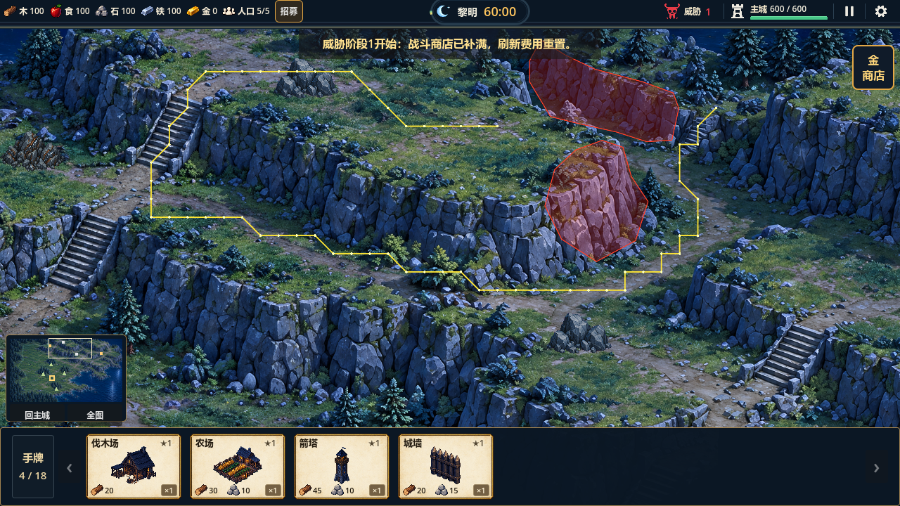
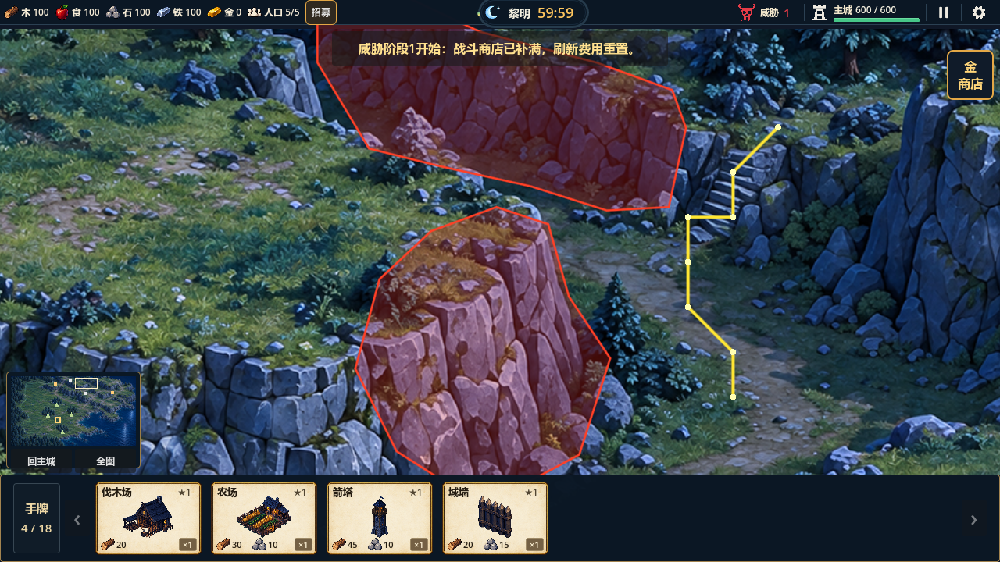

# 西北高台、前景岩壁与谷底连接纠正（2026-10-17）

上一版黄色路线确实从高台跨过前景岩壁进入谷底。原因是误把两个高度的地面标为同一条路，并缩小了前景岩面标注；测试只检查了错误数据自身，未证明与画面一致。[上一版报告](qa-2026-10-17-northwest-cliff-route.md)已标记为历史失败，13点、6.60秒短路的视觉验收结论撤销。

## 当前修正

- 恢复前景岩面的硬禁行轮廓，与后方岩壁同时保护；`(1005,95)`及`(1025,98)`重新确认是应阻断的高台边缘，禁止通行、建造和作为寻路终点。
- 西侧高台道路在岩缘前结束。到北侧石梯必须先经西侧石梯1下山，沿中层山路绕到谷底，再进入北侧石梯2。取消原先要求高台直接短距离接入谷底的错误测试条件。
- 新增南侧谷底路线，北侧石梯下端由西侧高台层改接谷底层；只表示连接关系，不引入高度战斗属性。谷底路半宽11源像素，收紧脚点至土路内，从石梯正面接入。
- 最终2744山域格、1054岩壁标注格、535道路/石梯格；世界大小、贴图、资源位置、单位速度和经济保持。

## 验证证据

| 检查 | 结果 |
|---|---|
| 山区专项 | 87项，包含前后两面岩壁禁行、真正下山路径、封闭西侧石梯后高台不可达、谷底入口及连续脚点检查 |
| 全量回归 | 33组1443项，0失败；`.codex-temp/cliff-topology-full.log`，逐组日志`.codex-temp/qa-20261017-123632/` |
| 大地图 | 120项，包含八资源真实建造/交付、8石梯双向通行、镜头和重开 |
| GL | 11项通过，退出0、无脚本/失败错误；`.codex-temp/cliff-topology-gl-final.log`，完整绕行与最大1.6谷底入口截图已检查 |
| 导航生成 | 执行`tools/build_mountain_routes.py`前后JSON的SHA256一致 |
| 项目检查 | `tools/check_project.ps1`、`git diff --check`通过；未提交或推送 |

西侧高台到北侧石梯上端实际65路径点、31.50秒，80世界像素/秒；每0.02秒推进检查脚点，未进入固体格及前后岩壁轮廓。封闭西侧石梯1后高台无法离开，证明不存在旧的穿崖连接。四矿真实往返仍为60.80、70.70、82.40、79.65秒，矿点占用后全部开放道路仍连通；真实农民、野狼和守卫的既有移动回归保持。

这是按实际石梯绕行的时间，不应为追求短路线重新缩小岩壁。三视口70项及真实输入28项仍为同日先前证据，本轮未重跑；首次寻路尖峰、其他36像素岩缘离散误差、单位避让、局部纹理接缝与自然长局平衡仍待后续。上述测试不替代用户对整体地形的视觉复核。

黄色是实际计算路径，红色是两面硬岩壁；仅在验证场景显示。干净画面为同目录`northwest-cliff-clean.png`。原错误截图保留在旧报告目录，并明确标记已被否定。
