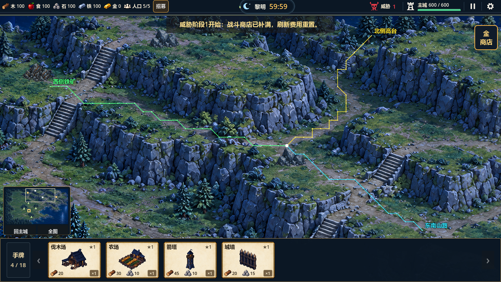

# 分叉路口按目的地选择最短路径（2026-10-17）

当前分叉与最短路径修正已通过受控验收：最终全量34组1467项，0失败；GL15项通过。地图、单位速度、资源产量及岩壁/石梯约束保持。未提交或推送。

## 改动

红圈处在母图`(980,205)`登记为中层三岔路口，西侧山路、北侧谷底与东南山路在同一节点衔接。道路数据只限定可走区域，不指定单位必须绕行哪一圈；农民、守卫和敌人仍通过共享寻路器按自己的目标选路。

修复实际游戏资源占用状态下的东南分支断点：原路线`(1044,254)→(1090,270)`贴着岩缘，导致单位绕北侧高台。调整为岩壁北侧可见土路`(1044,246)→(1070,249)→(1098,255)`，不缩小岩壁碰撞。到东南山路的实际最短代价从3601.50降为725.12世界像素。

候选交互入口原评分使用“路径点数×36＋到目标中心距离”，可能选择走得更远的入口。现按每段实际长度及既有地形权重比较；同总代价才比较靠近目标中心的程度，不再将未实际走过的外围至中心距离加入成本。正交36、斜行约50.91；山路权重均为1，因此比较实际长度，沿岸仍沿用既有权重。

已复现同一夹具旧算法行走152.735、新算法137.823世界像素；证据`.codex-temp/junction-distance-before-after.log`。占用版本变化后路径缓存仍立即失效；近路封闭时自动改道，解除后重新选择近路。

## 验证

新增`test_junction_routes`23项，使用真实主场景及全部资源占用，独立Dijkstra核对AStar结果。检查三支路、四类目的地、岩壁/跨层、北侧封路改道/恢复，以及多个交互入口的真实步行代价。刻意不强制远端铁矿走画面中某一方向，而以合法最短结果为准。

| 目的地 | 选路结果 | 实际代价 / 独立最短代价 |
|---|---|---:|
| 北侧高台 | 北侧谷底与石梯2 | 794.56 / 794.56 |
| 东南侧石矿 | 东南支路的可达交互格 | 36.00 / 36.00 |
| 东南山路 | 东南土路直接进入 | 725.12 / 725.12 |
| 西侧铁矿 | 西侧山路 | 1112.38 / 1112.38 |

以上为36像素权威格的最短代价，非连续空间任意走线保证；交互目标按可达停距结束，因此石矿无需走到建筑中心。

山区87项、大地图120项及分叉23项已通过。GL15项通过、退出0，无脚本/失败错误；日志`.codex-temp/junction-gl-final.log`。导航重建前后SHA256一致。三视口70项、输入28项仍是同日先前证据，本轮未重跑。

最终全量日志`.codex-temp/junction-full-complete.log`，逐组日志`.codex-temp/qa-20261017-150706/`。初版新数据全量34组1459项、1组箭塔夹具失败，修正合法部署覆盖后重新运行完整套件通过；不是将先前失败日志当作通过。`tools/check_project.ps1`及`git diff --check`通过。最终权威数据为1054岩壁标注格、538道路/石梯格和1个分叉标注。

四矿实际往返：iron_02为60.40秒，stone_01为70.70秒，stone_02为67.40秒，iron_01为79.65秒；四林10.25～13.75秒。旧stone_02为82.40秒，改善来自真实通路接通与入口选择，没有提高移速或产量。

回归中箭塔清场用例曾失败：旧固定西侧塔射程256，东侧城门敌人距塔325.99，塔无法覆盖。现把该用例的塔通过真实建造入口放在可覆盖四向城门的合法落点，补覆盖范围断言；仍严格检查4狼击杀、220实际伤害、主城存活、下一波与重置，没有修改生产塔射程、敌人伤害或迫使敌人绕进塔射程。证据`.codex-temp/junction-tower-coverage-before.log`，修正后17项通过。

首次寻路尖峰、其他岩缘离散误差、动态单位重叠、局部纹理接缝和60分钟平衡仍待后续。最近入口选择可能改变敌人抵达城门的位置，默认西侧单塔不保证覆盖全部方向，不能据受控清场用例宣称自然战斗已平衡。

黄线为北侧高台，青线为东南山路，绿线为西侧铁矿；白点为共同分叉。线条与文字仅存在于验证场景，正常游戏不显示。
