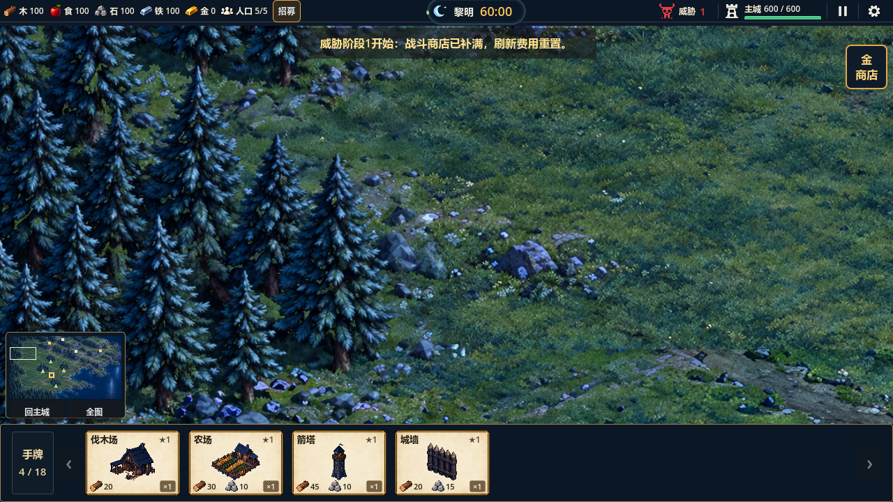

# 山区限路通行与树林浅色轮廓复验（2026-10-17）

结论：当前运行候选通过受控功能与GL复验，上次10月15日的“修复中”已收尾。最终美术、首次寻路尖峰、动态避让及60分钟自然平衡仍未完成。当前工程位于`D:\MyProject\waiting-for-dawn`，基线提交为`d3e1971`；本轮未提交或推送。

## 接续实现与本轮修复

山区玩法读取`assets/map/dawn_large_v1/mountain-navigation.json`，共有2744山域格、1019岩壁标注格和527道路/石梯标注格，36像素格及4608×2592世界保持。离路山地草台禁行但保留地形可建，岩壁禁建禁行；山路按平台层级连接，8处石梯按编号和上下端允许跨层，不能从中段跳进异层或斜切岩角。

四矿旁保留通路与采集入口，矿点占用后全部开放路格仍连通。农民、守卫和野狼共用合法边判断。山区岗位建筑需在完整占地外留60世界像素内的路边入口，交互线不能穿岩壁、水或树林；预览与实际投放一致，失败保卡保材料。民屋仍可建在离路草台。该检查保证附近入口存在，不保证玩家后续封路后所有岗位持续可达。

树林浅色边缘来自边界前景层附带的绿色草地贴片。固定素材材质以冷蓝树冠与浅绿底纹的色差裁除地面；对照中71709个冷蓝树冠抽样像素全部保留，46445个像素产生明显变化。只适配当前固定素材，不是通用抠图或最终美术批准。

本轮另发现空闲农民逐帧搜索待命落点，导致聚落边界回归两次超过30秒。新增有界脚点缓存，在地形/建筑占用版本变化时立即失效；保留真实路径与采集推进，不放宽超时或删除交付断言。修复后聚落边界90项约6秒完成。补充脚点被占用/释放、封梯停步/恢复及全部8梯反向通行测试。

## 验证证据

| 检查 | 结果 |
|---|---|
| 最终全量 | 33组1427项，0失败；`.codex-temp/resume-20261017-full-final.log`，逐组日志`.codex-temp/qa-20261017-085350/` |
| 山区专项 | 71项：四矿完整交付、开放路网连通、离路草台规则、红框岩壁、跨层约束、封梯/恢复、真实野狼/守卫下山、投放保卡 |
| 大地图专项 | 120项：八资源实际建造/交付、全部8梯双向通行、地图镜头/小地图及重置 |
| 寻路与单位 | 算法15项、实际单位18项；脚点占用变化立即失效，不穿固体格 |
| GL三视口 | 960×540、1280×720、1024×768，共70项；`.codex-temp/resume-20261017-regression-gl-final.log`，退出0，无脚本/失败错误 |
| 树林GL专项 | 6项含4张截图和2项像素对照；`.codex-temp/resume-20261017-mountain-gl-final.log`，退出0 |
| 引擎真实输入 | 鼠标/触控缩放平移、拖牌、岗位、商店、18手牌与翻页28项；`.codex-temp/resume-20261017-input-gl-final.log`，退出0 |
| 导航离线数据 | 执行`tools/build_mountain_routes.py`前后SHA256一致，未改地图世界大小或资源脚点 |
| 项目检查 | `tools/check_project.ps1`与`git diff --check`通过；既有导入配置和项目设置改动保留 |

最初全量33组1359项通过、1组超时，不作为最终基线；独立复现也超时，临时性能诊断保存在`.codex-temp/profile-edge.*`。修复后专项及完整回归重新通过。10月14日高清素材原稿与确定性QC属于历史证据，本轮未重新生成或重建高清素材。

## 运输与性能

单农民原速80世界像素/秒，采集后送回主城才入账；本轮没有提高速度或产量补偿绕路。

| 资源 | 受控往返耗时 | 路径总长（世界像素） |
|---|---:|---:|
| forest_02 | 14.10秒 | 1050.9 |
| forest_04 | 11.55秒 | 828.7 |
| forest_03 | 12.50秒 | 883.9 |
| forest_05 | 10.45秒 | 758.4 |
| stone_01 | 70.70秒 | 5579.1 |
| stone_02 | 82.40秒 | 6515.1 |
| iron_01 | 79.65秒 | 6257.0 |
| iron_02 | 60.80秒 | 4782.0 |

50实际单位推进180帧，更新P95为0.860ms，最大258.337ms，GL帧间P95为7.558ms，CPU静态内存监视值76.41MiB。首次路径更新尖峰明显高于旧地图基线，仍可能出现短暂停顿，必须继续优化；不能只用P95宣称稳定60fps。CPU静态内存不代表GPU显存。50次同目标寻路请求含首次计算为23.64ms。

## 画面

同目录`border-before.png`为相同镜头关闭地面裁除的对照；`full-map.png`为全图。`regression/`保留三视口、上下栏裁剪、近树不透明、占用/释放、最大倍率、地图四角与50单位压力画面。历史10月15日四张截图保持原文件，本轮证据单独保存。

## 后续

1. 优先降低首次寻路/连接同步峰值，分别测冷启动与占用变化，不以放宽测试超时替代修复。
2. 动态单位仍可重叠；补局部避让与狭窄石梯会车验证。
3. 树林外浅色草地轮廓已处理，但局部地面分块纹理仍有接缝；岩缘36像素离散误差与固定素材颜色裁除需美术目检。
4. 四矿运输增加至60.80～82.40秒，需自然长局验证经济和来袭节奏；尚无完整60分钟平衡、正式美术或发行验收结论。
