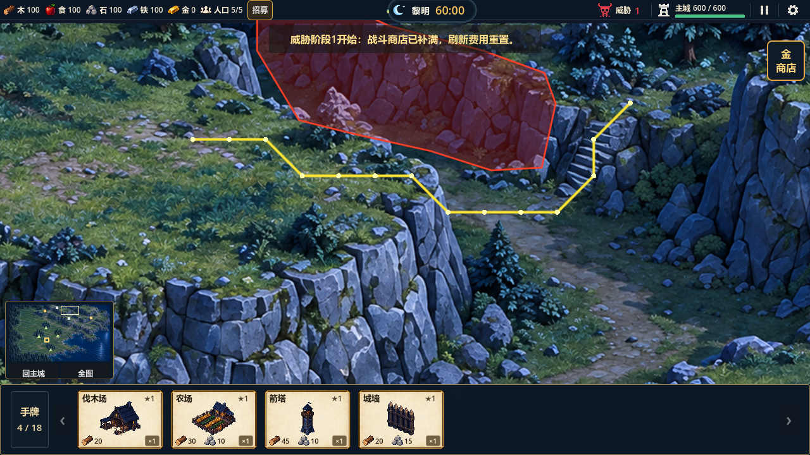

# 西北石壁与石梯入口路线修正（2026-10-17）

> 已被用户截图否定：下方原报告的“13点、6.60秒短路”仍跨越前景岩壁，不能作为视觉或通路验收通过依据。原测试只验证了错误标注本身。后续撤销该短路，恢复前景岩面并沿西侧石梯与谷底绕行，最新状态见开发记录及石壁连接关系纠正报告。以下保留为历史排查记录。

用户新截图红框位于西北石梯左侧岩壁。已校正固定地图标注并通过受控验证；未修改地图贴图、世界大小、资源位置、速度或经济数据。

## 问题与修正

旧路网沿母图`(960,70)→(980,74)→(1010,74)→(1030,80)`横切岩壁坡脚。对照旧数据实际复现：源坐标`(980,74)`、`(1000,74)`、`(1020,74)`、`(1040,80)`对应的格原先全部为可走道路，修正后全部为禁行禁建岩壁。日志：`.codex-temp/cliff-correction-before-after.log`。

在`tools/build_mountain_routes.py`新增上层岩壁硬禁行轮廓，硬岩面向外保护4源像素，优先级高于石梯宽度容差。重排下方山路为`(945,78)→(972,83)→(1000,87)→(1027,91)→(1050,97)→(1065,95)`，再接原石梯2下端。同步校正前伸平台真正岩面上缘，保留两面岩壁之间可见的草地通道，避免把单位逼得绕行全山。

早期`(1005,95)`样本实际位于平台后方通道，已改为真正立面`(1005,130)`，保留另一立面`(1020,110)`；新增4个红框样本的禁行禁建和不可寻路断言。最终人工标注为2744山域格、1045岩壁标注格及528道路/石梯格。

## 验证

| 检查 | 结果与证据 |
|---|---|
| 山区专项 | 81项通过；`.codex-temp/cliff-correction-mountain-evidence.log`、`.codex-temp/qa-20261017-094922/` |
| 局部路线 | 13路径点，原速80世界像素/秒，6.60秒到达石梯上端；逐帧未进入固体格或红框岩壁多边形，不绕行全山 |
| 四矿与路网 | 四矿真实采集/交付保持；所有开放山路与8石梯在资源占用后仍连通，野狼/守卫真实下山通过 |
| 大地图 | 120项通过，含八资源实际建造/交付、8梯双向通行、重开与镜头 |
| 最终全量 | 33组1437项，0失败；`.codex-temp/cliff-correction-full-final.log`、`.codex-temp/qa-20261017-094731/` |
| GL专项 | 9项通过，退出0，无脚本/失败错误；`.codex-temp/cliff-correction-gl-final.log`，含最大1.6倍率干净画面及实际路径叠图 |
| 离线数据 | 导航JSON重建前后SHA256一致；原地图、高清贴图及资源位置未改 |
| 项目检查 | `tools/check_project.ps1`、`git diff --check`通过；未提交或推送 |

首轮中间标注导致局部通道断开，路径绕行全山，首轮全量4组失败；重新校准上下岩面的边缘及路肩后通过最终全量。局部路线测试限制路径点数，并逐帧检查真实脚点，避免仅以“最终可达”接受远距离绕行。未延长测试超时或减少矿物交付断言。

四矿受控往返仍为60.80、70.70、82.40、79.65秒；原有树林GL对照同时通过。此次未重跑三视口70项及真实输入28项，它们仍是上一轮证据，当前9项为新增局部GL证据。首次寻路尖峰、动态单位重叠、局部纹理接缝和60分钟自然平衡待后续。

红色为岩壁禁行轮廓，黄色为实际寻路结果；叠图仅在验证场景出现。干净画面为同目录`northwest-cliff-clean.png`。
