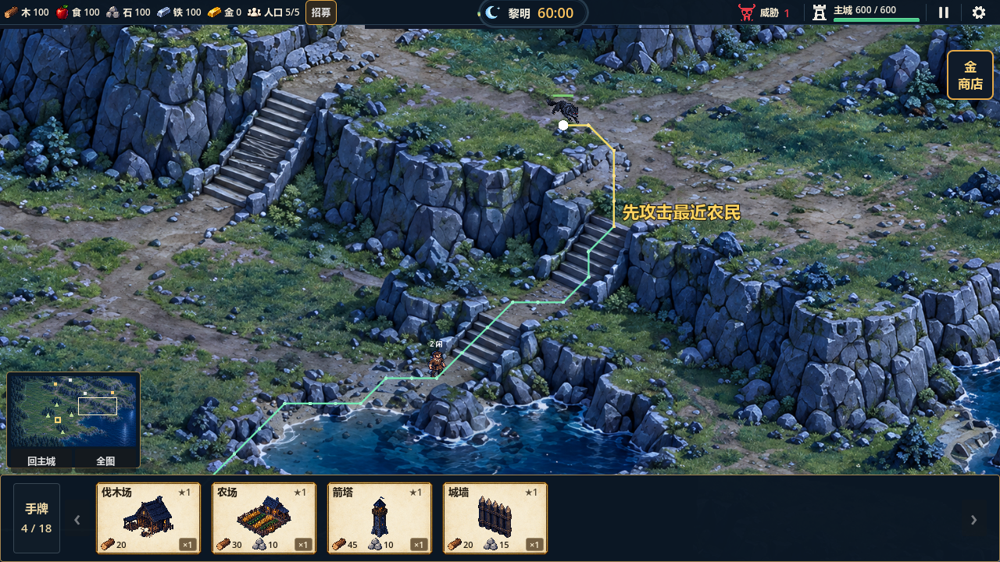

# 野怪最短进城与沿途最近目标（2026-10-20）

本轮专项33项、全量36组1518项、真实GL8项通过，0失败；S6未提交成果保留，未提交或推送本轮改动。

## 问题与最终行为

原野怪移动使用网格绕行，索敌却按“当前位置到主城的直线”扫描；因此弯路上的农民和守卫会被漏掉，直线附近的路线外单位反而吸引野怪。出生时只存目标，首次移动才准备路径。

现在出生即选择到主城96像素外围的最短合法路线，索敌沿实际剩余路径走廊（目标半径加默认14像素）筛选并检查地形遮挡。对可攻击候选查询合法攻击入口，比较实际段长乘既有地形权重，同代价按直线距离消歧；不是按数组、路径点数或主城方向投影选目标。路线外、身后及无法抵达攻击入口的目标不参与，目标死亡/离路后继续扫描；已贴身交战守卫保留既有一对一互伤。

完全封路时，在独立导航副本中只去掉已登记可摧毁建筑的占用以定位阻挡物；实际追击仍使用原网格和合法攻击入口。不能走参考线穿建筑，也不忽略岩壁、湖水、石梯或未登记占用。破障后释放占用，恢复进城；地形完全断路且无破障方向时停步。

攻击前重新核对距离和地形遮挡，禁止隔墙近战。目标位移不足18像素但已离开停距时仍重算追击，避免停在旧终点；未改速度、伤害、奖励、经济或地图尺寸。

## 验证证据

新增`tests/test_enemy_attack_routes.gd`33项，包含必须先远离主城方向的折返通路、直线误导/不可达目标排除、实际农民受击、死亡接力、移动脱离、更近目标加入、守卫接敌/释放、按实际路程而非直线距离选近目标、稳定扫描不重置路径与攻击计时、17像素位移脱离近战后重新接近，以及真实静态城墙封路/墙前攻击/破墙恢复/地形断路停步。

四个实际地图出生点在同一真实资源/主城占用下，分别以独立Dijkstra计算最短入口代价，并让野狼实际移动到主城外围；路径逐边遵守岩壁与石梯限制。出生次序随局号可复现地打乱，四条路线的代价集合为1100.03、1345.85、1936.76、3396.79世界像素加权单位，路径点数分别26、32、48、84。

- 最终全量：`.codex-temp/enemy-routes-full-final.log`；逐组日志`.codex-temp/qa-20261020-161939/`。36组1518项，0失败；含山区87、大图120、S6 18、分叉23、城墙32与守卫46项。
- 最终GL：`.codex-temp/enemy-routes-gl-final.log`，8项通过，退出0，无脚本错误；包含4项实际状态与4张截图。使用真实主场景、山区野狼及两名沿途农民，验证最近者先受击、主城未被直接伤害及死亡后下一目标接力。
- 编辑器导入：`.codex-temp/enemy-routes-import.log`，无脚本错误；项目结构、文档链接、`git diff --check`与暂存差异检查通过。
- 改动前用例`.codex-temp/enemy-routes-before.log`为7项行为失败的复现记录，不作为通过证据。新增小幅位移夹具初版15像素仍在52像素攻击范围内，改用17像素明确越出范围后通过；没有放宽攻击距离。

## 实景

绿线为最短进城路线，黄线为最近目标的合法攻击入口路线，仅验证场景显示。[出生进城路线](images/enemy-routes-2026-10-20/spawn-city-route.png) · [实际攻击最近农民](images/enemy-routes-2026-10-20/attacking-nearest.png) · [死亡后接力目标](images/enemy-routes-2026-10-20/next-route-target.png)。

## 限制

完整60分钟自然布防、更多野怪同时索敌、首次寻路尖峰与动态避让仍待验证。入口和遭遇对象随建筑布局变化，不能据受控用例保证默认单塔守住四方或宣称难度已平衡。三视口与鼠标/触控输入沿用历史证据，本轮没有重复这些检查。
