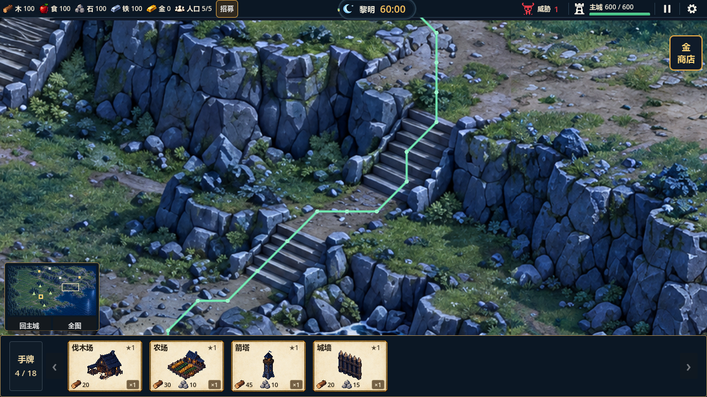

# S6双段石梯路线校正（2026-10-20）

S6已按可见的下段石梯、中间平台、上段石梯校正。全量35组1485项、专项18项和GL6项通过，退出码0；本轮未提交或推送。

## 原因与改动

旧S6用单条斜线连接南侧山脚和上层山路，偏向左侧岩壁，无法经过画面中错开的两段踏面。此次调整导航生成器与生成JSON，不改运行寻路算法、速度、经济或地图尺寸。

母图坐标中的S6参考线改为`(1138,459)→(1162,430)→(1185,426)→(1206,418)→(1216,396)→(1222,379)`。R03从南侧山脚接下段，R12从上端土路接R11；补两侧硬岩约束，局部岩面轮廓按真实踏面及土路分开。其他15段山路和7处石梯配置与旧基线一致。

当前山域2744格、岩壁1050标注格，道路436格、石梯111格，共547登记格；总览保留17路、8梯、4矿点。36像素网格和既有跨层端点规则保持。

## 验证

- `test_s6_stair_alignment`18项：旧穿岩样本及侧墙禁行禁建；上下山均访问两段踏面与平台；以80世界像素/秒逐帧移动检查合法边及硬岩外脚点；农民完成采集往返，野狼和守卫实际下山。上下山各16个路径点，均680.38世界像素。
- 分别封闭上段和下段后，单位改走其他石梯绕行，不跨侧墙；解除后恢复S6原路线与缓存结果。
- 全量35组1485项、0失败，含山区87项、大地图120项、分叉23项。总日志`.codex-temp/s6-full.log`，逐组日志`.codex-temp/qa-20261020-112713/`。
- 真实GL Compatibility6项通过；修正前后使用相同镜头、起终点取实际寻路。目检确认绿线上山经下段踏面、平台右转、上段踏面，黄线反向通过。日志`.codex-temp/s6-gl.log`；无脚本错误。引擎导入日志`.codex-temp/s6-import.log`。
- 四矿农民实际往返：iron_02为60.40秒、stone_01为70.70秒、stone_02为66.15秒、iron_01为78.40秒；矿点占用后未断开开放山路。西北既有绕行仍65点/31.50秒。
- 导航与图册PNG/JSON/README再次重建SHA256一致；图册源哈希等于当前导航。导航SHA256：`96569a5bf7bdec62ee18c8e1d1fdf2433fc28ad6d16eb20948b0d231dccc21c3`。确定性记录`.codex-temp/s6-deterministic.json`。
- `tools/check_project.ps1`、`git diff --check`及暂存差异检查通过；新增文档链接核对通过。三视口及真实输入沿用既有证据，本轮未重跑。

## 实景与路线图

[下山路径](images/s6-stairs-2026-10-20/s6-downhill-route.png) · [修正前穿岩对照](images/s6-stairs-2026-10-20/s6-before-route.png) · [纯地图](images/s6-stairs-2026-10-20/s6-clean.png) · [路径坐标](images/s6-stairs-2026-10-20/s6-paths.json) · [新版山区总览与连接表](../../design/levels/mountain-routes-2026-10-20/README.md)

线条仅用于验证场景，正常游戏不显示。图册导出支持日期和输出目录，不覆盖10月17日历史记录。

36像素格仍有其他岩缘离散误差；首次寻路峰值、动态单位避让及完整60分钟自然试玩未在本轮解决，不把此次局部实景检查当作整图最终美术验收。
