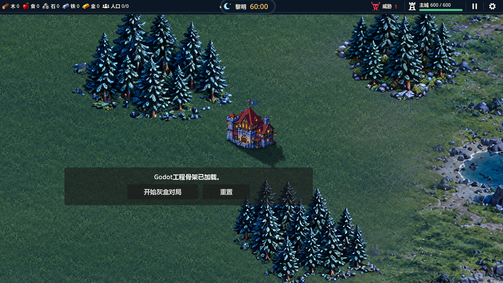
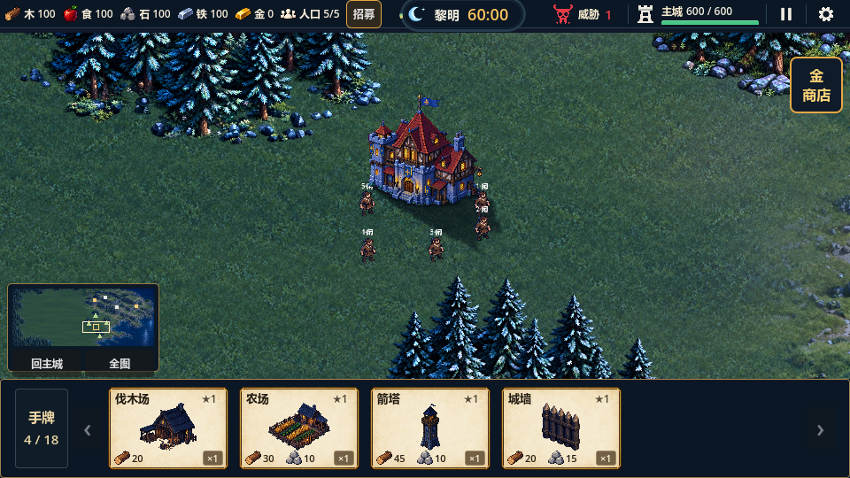
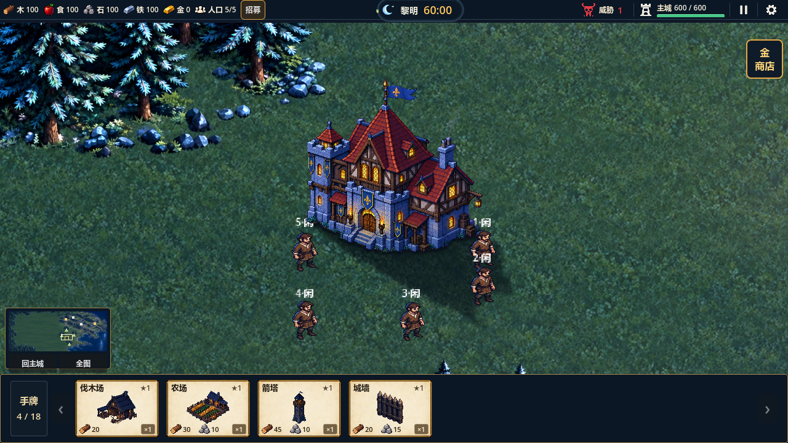

# 主城启动恢复与阴影修正

日期：2026-10-25。Godot 4.7 Standard，GL Compatibility。结论：已复现的启动脚本错误已修复，启动/选卡/迎战链路及阴影专项验证通过；最终美术仍待用户复核。

## 原因与改动

上一轮阴影代码改为读取`manifest.json`的`shadows`字段后，素材清单尚未重建，启动报`Invalid access to property or key 'shadows'`，定位`TownHallVisual._ready:36`。已同步重建素材与清单，并为不含该字段的旧清单保留原位置兼容路径。

旧投影将建筑底部压成水平线，接触影大部分藏在主体下，无法沿左墙、台阶、右墙贴地。现从生成主体alpha提取每列最下缘，构成窄接触带并按该列墙脚向右下投影；主体下部加入固定冷暗环境过渡。两张阴影使用1216×576透明图，共享世界矩形(-108,-54,304,144)，位于地形上方、单位下方；尺寸、占格、附着动画与玩法规则保持。

修复开始时工作副本干净，但`production/project-state.yaml`存在已提交的合并冲突标记；已保留活动Story-032与原地图待办并清除冲突。生成清单的来源哈希排除本地自动生成的`.import`文件，原始PNG/提示词/记录继续核查。

## 验证

- 主城专项22项通过：`.codex-temp/qa-20261025-023557/`。新增启动按钮/顶栏可见、完整初始化及旧清单两层兼容检查；原暂停、重开、胜负和效果释放保持。
- 地形专项70项通过：`.codex-temp/qa-20261025-023647/`。
- 三视口960×540、1280×720、1024×768真实GL71项通过，日志`.codex-temp/town-gl-final-20261025.out.log`，同名错误日志为空。覆盖启动按钮→六张候选→选四迎战HUD、默认/1.6近景及暂停/重开。
- 冻结所有动画，分别开关接触影和投影；左墙、台阶、右墙外侧3×3地面样本亮度降低16.3%～34.0%，右下投影样本降低超过20%。这些只作为定位与对比回归，最终观感仍以真实截图和用户复核为准。
- `tools/check_town_hall_assets.py`通过：16项产物确定性、透明边缘、12帧差异/边界、原稿哈希。主体及动画帧无内容变更。
- Godot重新导入、主场景headless启动无脚本报错；`tools/check_project.ps1`和`git diff --check`通过。

本轮未重跑全量；38组1560项为10月23日历史基线。未验证性能、完整Y排序与60分钟自然试玩，原地图交界和首次寻路尖峰保留。未提交/推送。

## 实际游戏截图

启动界面（1280×720）：

默认镜头（960×540）：

近景（1280×720）：

已目检启动、默认与近景：地面仍可透过阴影看到草地纹理，左墙和台阶不再悬空，右下投影在默认镜头可辨。固定二维投影仍是美术近似；原设计板不等于实际游戏场景，不宣称像素级还原。
