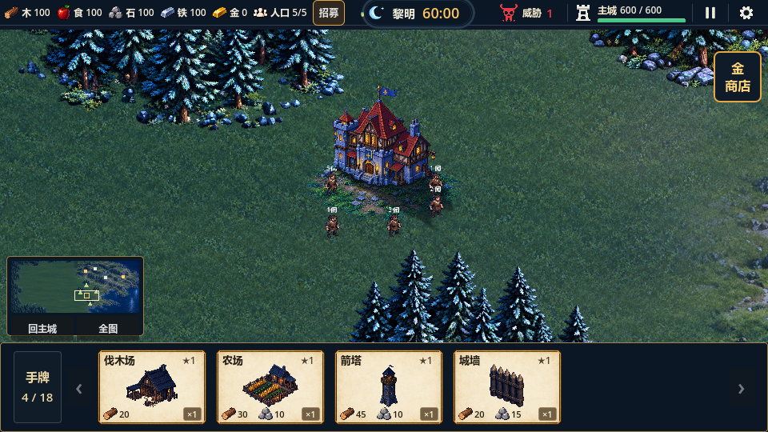
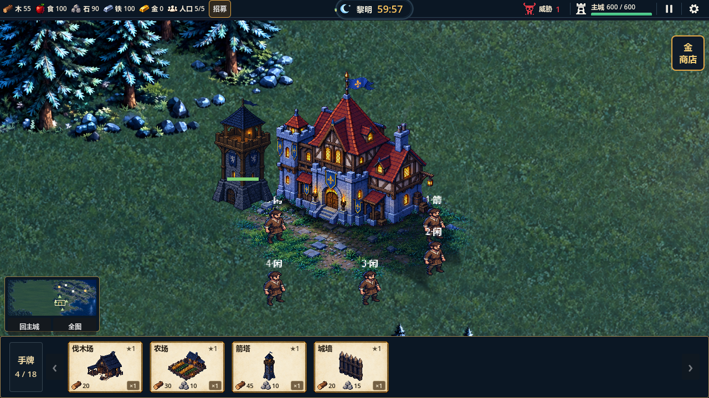
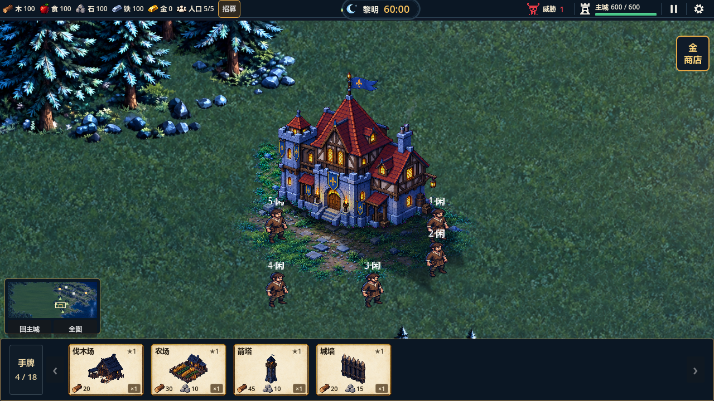
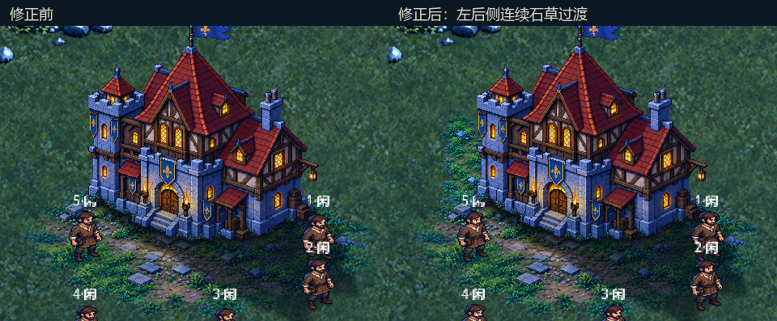

# 主城地面底座接入验证

日期：2026-10-26。Godot 4.7 Standard，GL Compatibility。结论：地面底座接入及用户红框左后侧修正通过相关检查，最终观感待用户复核；未提交/推送。

## 实现

用户确认[场景设计](../../design/art/concepts/town-hall-base-2026-10-26/town-hall-ground-base-v1.png)后，内置image_gen独立生成1816×866地面原稿，generate2dsprite单图去底，再确定性裁边、等比缩放、夜景调色和外缘透明度渐变，首版得到1248×600运行贴花，后续补独立左后侧草缘并扩为1280×792。包含低矮石块、半埋旧石板/压实泥土、细碎石和渐疏短草，没有直接切割概念场景。

`TownHallVisual`将底座绘制到现有独立地面层中，在投影/接触影、主体、人物下方，世界矩形为`(-166,-120,320,198)`。主城主体、附着动画、180×176显示框和4×4占地保持；底座不接收输入，不写导航、占用或碰撞。

## 验证结果

| 检查 | 结果与证据 |
|---|---|
| 主城专项 | 31项通过，`.codex-temp/qa-20261026-122427/`；含底座层级、静态变换、16格占用、相邻草地可建、原树林禁建、重开保持及退出释放 |
| 地形回归 | 70项通过，`.codex-temp/qa-20261026-122430/` |
| 农民物流 | 25项通过，`.codex-temp/qa-20261026-122433/`；运输、交付与重开恢复保持 |
| 地图建造/镜头 | 59项通过，`.codex-temp/qa-20261026-122437/` |
| 三视口真实GL | 104项通过，退出0、错误日志为空；`.codex-temp/town-base-rear-final.out.log`及同名错误日志 |
| 底座素材 | `tools/check_town_hall_base.py`通过：PNG/清单确定性重建、两份采用原稿/参考哈希、四边透明、可见像素中渐疏alpha占比27.2%、无紫边、台阶及左后侧地面连续 |
| 原主城素材 | `tools/check_town_hall_assets.py`通过，主体、12帧动画及原阴影产物保持确定性 |
| 其他 | Godot导入/主场景启动、`tools/check_project.ps1`及`git diff --check`通过 |

相关headless合计4组185项。本轮不重跑全量，38组1560项为10月23日历史基线。

GL覆盖960×540、1280×720、1024×768的启动→六选四→迎战HUD、默认/1.6近景、两层阴影、底座开关对照、范围外地表无变化、暂停和重开。1280窗口通过真实卡牌接口在`主城+(-126,-18)`建造箭塔，截图检查箭塔、人物与底座同时显示。底座开关只作用于地面Sprite，不把建筑/动画一起隐藏。

新增测试最初将`主城+(0,108)`误当作可建草地，实际为既有南侧树林禁建格；已核对权威地形，改用合法的`(-36,90)`并保留该树林禁建断言，没有放开地形限制。原稿色键背景存在轻微色差，源边缘检查按洋红色域判断，无草石触边；结果PNG四边严格透明。

## 实景

默认镜头：

最大1.6倍率：

底座附近真实建造箭塔：

已目检默认、最大倍率和相邻建筑：台阶接入院前石土地面，阴影覆盖地面时仍可辨石板；外缘草叶渐疏，没有不透明矩形底片，人物可显示在草缘之上。新增草簇比底图细草更显著，最终疏密/色调仍需用户观感复核。

本轮未完成完整Y排序、性能压力或60分钟自然试玩。原地图交界、首次寻路尖峰和动态避让待办保留；底座是视觉装饰，其范围不等于新的可建区域或硬占地。

## 用户红框追加修正

用户截图指出左塔楼侧后方缺少设计中的石草过渡；首版门前底座的局部目检未覆盖该差异。现独立生成左后侧素材，斜向首稿放置后尾部被主体遮住，第二稿改为沿画面纵向延伸，并保持原石块俯视光照。运行采用第二稿，首稿仅保留为参考来源；完整原稿、两份提示词、处理与SHA256记录均保存。

左后侧层世界矩形`(-144,-110,110,125)`，与门前层`(-158,-72,312,150)`按原脚点透明合成，总画布1280×792。未拉长门前地面、主体或动画，也不增加导航/占地。最大倍率已对照红框复核，草缘沿左墙从后方连续接到前方。

三视口默认/近景新增三个左墙地面邻域的开关对照，总GL104项通过。使用5×5邻域允许草叶之间的自然透明空隙；单像素恰好落在空隙时不能作为连续地表判据。素材检查按可见像素计算半透明占比，避免扩展透明画布改变指标分母。

首次复验有一张启动截图与用户已打开的Godot编辑器导入发生文件锁争用；截图工具改为先写`.codex-temp/town-base-rear-evidence/`，进程结束后拷贝报告目录，最终104项/退出0/错误日志为空。

修正后的最大倍率：

同一镜头实景裁图对比（仅裁切和加标题，未修改地面内容）：

范围、功能验证与原性能限制保持上述结论，最终草缘疏密与色调仍待用户观感复核，不把本轮检查当作与概念图逐像素还原的证据。
